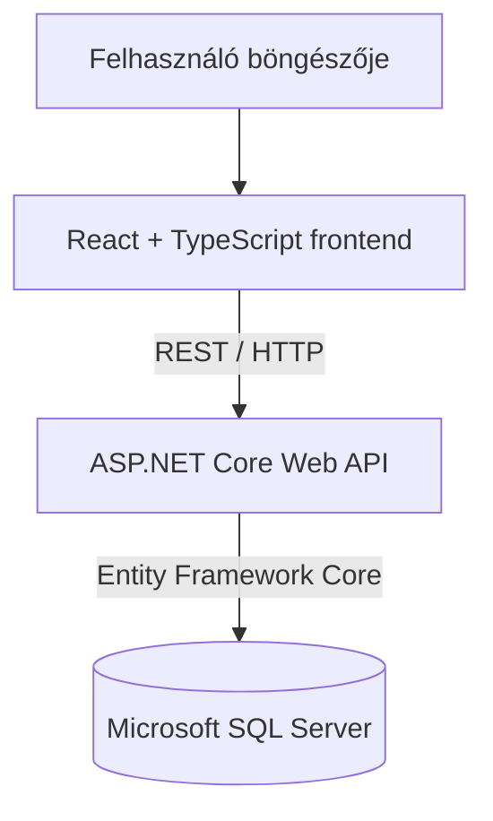

# Egyetemi Kulcs- és Teremnyilvántartó Rendszer

Az alkalmazás egyetemi teremfoglalások, teremkulcsok, karbantartási idősávok és a kapcsolódó események digitális kezelésére szolgál.

## Technológiai stack

- **Frontend:** React, TypeScript, Vite
- **Backend:** ASP.NET Core Web API (.NET 8)
- **Adatbázis:** Microsoft SQL Server
- **Adatelérés és migrációk:** Entity Framework Core
- **Hitelesítés:** JWT, szerepkör-alapú hozzáférés-vezérlés (RBAC)
- **Futtatás:** Docker Compose

## Rendszerarchitektúra



Az adatbázis közvetlenül nem érhető el a böngészőből; a frontend a backend API-n keresztül kommunikál vele.

## Előfeltételek és konfiguráció

Docker Desktop vagy Docker Engine Docker Compose támogatással szükséges. Helyi, konténer nélküli fejlesztéshez Node.js/npm és .NET 8 SDK is kellhet.

Készíts helyi `.env` fájlt a példából:

```bash
cp .env.example .env
```

PowerShell alatt:

```powershell
Copy-Item .env.example .env
```

A Docker indítása előtt állíts be egyedi, az MSSQL jelszókövetelményeinek megfelelő `MSSQL_SA_PASSWORD` értéket. Generálj egy legalább 32 bájtos JWT-aláíró kulcsot, például `openssl rand -base64 48` paranccsal, és másold a `JWT_SIGNING_KEY` változóba. A `JWT_ISSUER`, `JWT_AUDIENCE` és opcionálisan a `JWT_EXPIRES_IN_HOURS` értékei is konfigurálhatók. A `.env.example` nem tartalmaz használható JWT-kulcsot: a Compose konfiguráció ellenőrzése üres kulccsal is lefut, de a backend induláskor elutasítja azt, amíg nincs beállítva érvényes, legalább 32 bájtos kulcs. A `.env` fájlt és valódi hitelesítő adatokat ne commitolj.

A backend JWT-alapú hitelesítést és szerepkör-alapú jogosultságkezelést használ. A token `sub` claimje a felhasználó adatbázisbeli azonosítóját, `role` claimje pedig a szerepkört tartalmazza; az írási műveletekhez szükséges szerepköröket az egyes végpontok RBAC-szabályai határozzák meg.

## Indítás Docker Compose segítségével

A repository gyökerében:

```bash
docker compose up --build -d
docker compose ps
```

Naplók:

```bash
docker compose logs -f
docker compose logs -f backend
docker compose logs -f frontend
docker compose logs -f mssql
```

Leállítás:

```bash
docker compose down
```

A normál leállítás megtartja az adatbázis volume-ját. Ne használd a `docker compose down -v` parancsot, ha meg szeretnéd őrizni az adatokat.

| Szolgáltatás | Gazdagép | Konténer | Elérés |
|---|---:|---:|---|
| Frontend | `3000` | `3000` | `http://localhost:3000` |
| Backend API | `5000` | `5000` | `http://localhost:5000` |
| MSSQL | `1433` | `1433` | SQL-kliensből, a `.env` hitelesítő adataival |

A frontend a backend egészségellenőrzésének sikeréig nem indul el; a backend pedig megvárja az adatbázis egészséges állapotát. A backend konténer az `APPLY_MIGRATIONS=true` beállítással indul, és alkalmazza a függő EF Core migrációkat.

## API és hitelesítés

Fejlesztési környezetben a Swagger UI címe `http://localhost:5000/swagger`; az OpenAPI leírás a `http://localhost:5000/swagger/v1/swagger.json` útvonalon érhető el. A Swagger felületen a bejelentkezés után a JWT `Authorize` funkcióval használható.

- `GET /api/health` – adatbázis-kapcsolatot is ellenőrző health check; nem igényel hitelesítést.
- `POST /api/auth/login` – felhasználónév és jelszó alapján JWT-t ad vissza.
- `GET /api/auth/me`, `POST /api/auth/logout` – a hitelesített felhasználó adatai, illetve kliensoldali kijelentkezés.
- `/api/users`, `/api/rooms`, `/api/keys`, `/api/key-movements`, `/api/bookings`, `/api/tickets` – felhasználó-, terem-, kulcs-, kulcsmozgás-, foglalás- és hibajegy-végpontok; a részletes jogosultságokat az endpointok RBAC-szabályai határozzák meg.
- `/api/maintenance` – karbantartási idősávok listázása és kezelése.
- `/api/keys/{id}/master-access` – mesterkulcs-hozzáférések kezelése.
- `/api/reliability` – oktatói megbízhatósági pontszámok és események.
- `/api/parameters` – rendszerparaméterek lekérdezése és adminisztrátori módosítása.
- `/api/audit` – adminisztrátori auditnapló-lekérdezés és szűrés.
- `/api/reports` – napi, heti, teremkihasználtsági, kulcsforgalmi és megbízhatósági riportok.
- `/weatherforecast` – a `main` ágról megőrzött, nyilvános ASP.NET minta-végpont.

A karbantartási, mesterkulcs-, rendszerparaméter-, audit-, riport- és megbízhatósági műveletek hitelesített JWT-t igényelnek; a szerepkör-korlátozott műveleteket a backend ellenőrzi. Az értesítési entitás szerepel az adatmodellben, de az értesítési végpontok és szolgáltatás még nincsenek implementálva. Az egyes végpontok és DTO-k részletei a Swagger dokumentációban és a `docs/API_DESIGN.md` fájlban találhatók.

### Karbantartás, mesterkulcsok és megbízhatóság

- Karbantartás: `GET /api/maintenance` (opcionális terem- és időtartomány-szűrőkkel), `GET /api/maintenance/{id}`, valamint `POST`, `PUT` és `DELETE` műveletek. Az írási műveletek adminisztrátori jogosultságot igényelnek; foglalással ütköző idősáv `409 Conflict` választ ad.
- Mesterkulcs: `GET` és `POST /api/keys/{id}/master-access`, illetve `DELETE /api/keys/{id}/master-access/{userId}`. A jogosultságkezelést adminisztrátor végezheti; csak mesterkulcshoz adható hozzáférés.
- Megbízhatóság: `GET /api/reliability/users/{userId}`, `GET /api/reliability/users/{userId}/events`, `GET /api/reliability/my`, és adminisztrátori `POST /api/reliability/correction`. A pontszám eseményekből számítódik, és 0–100 közé korlátozott.

Példa health check és teremlekérdezés:

```http
GET http://localhost:5000/api/health
GET http://localhost:5000/api/rooms
```

A teremlista és az egy terem adatait visszaadó `GET /api/rooms` és `GET /api/rooms/{id}` végpont nyilvános, ahogy a főágbeli API is működött. A módosító terem-végpontok hitelesítést és megfelelő RBAC-szerepkört igényelnek.

## API részletek

- **Sikeres válasz (HTTP 200 OK):** A kiválasztott terem DTO adatai.
- **Ha nem található (HTTP 404 Not Found):** `{"message": "A(z) {id} azonosítójú terem nem található."}`

### Mesterkulcs-jogosultságok

A jogosultságok kezeléséhez hitelesített, `Adminisztrátor` szerepkörű felhasználó szükséges. A POST-kérés JSON-törzse:

```json
{ "userId": 123 }
```

| Metódus | Útvonal | Művelet |
|---|---|---|
| `GET` | `/api/keys/{id}/master-access` | A mesterkulcshoz jogosult oktatók listázása |
| `POST` | `/api/keys/{id}/master-access` | Jogosultság adása egy oktatónak |
| `DELETE` | `/api/keys/{id}/master-access/{userId}` | Jogosultság visszavonása |

A végpontok csak `Mesterkulcs` típusú kulcsot fogadnak el; hozzárendeléskor a megadott felhasználónak `Oktató / Igénylő` szerepkörűnek kell lennie.

## Karbantartási idősávok API

- `GET /api/maintenance?teremId=1&startTime=2026-11-02T08:00:00Z&endTime=2026-11-02T18:00:00Z` – idősávok listázása; minden szűrő opcionális, az időtartomány az átfedő idősávokat adja vissza.
- `GET /api/maintenance/{id}` – idősáv részletei.
- `POST /api/maintenance` – új idősáv rögzítése.
- `PUT /api/maintenance/{id}` – idősáv módosítása.
- `DELETE /api/maintenance/{id}` – idősáv törlése.

A létrehozási és módosítási kérések törzse: `teremId`, `startTime`, `endTime`, valamint opcionálisan `leiras`. Az írási végpontok csak adatbázisban is adminisztrátori szerepkörű, megfelelő JWT-vel hitelesített felhasználó számára érhetők el. A foglalással ütköző idősáv `409 Conflict` választ eredményez; a megszüntetett foglalások nem blokkolják a karbantartást.

## Megbízhatósági pontozás API

- `GET /api/reliability/users/{userId}` – az oktató aktuális tanévi pontszáma (0–100), valamint az aktuális következmény.
- `GET /api/reliability/users/{userId}/events` – az oktató összes pontozási eseménye, beleértve a korábbi tanévek előzményeit.
- `GET /api/reliability/my` – a bejelentkezett oktató saját aktuális tanévi pontszáma.
- `POST /api/reliability/correction` – adminisztrátori pontkorrekció; törzse: `userId`, `pont` (nullától eltérő egész szám, negatív korrekció is lehetséges) és kötelező, legfeljebb 500 karakteres `indoklas`.

A pontszámot a backend az eseményekből, időrendi sorrendben számítja, és minden esemény után 0–100 közé korlátozza. A tanév szeptember 1-jén kezdődik; a korábbi tanévek eseményei és auditbejegyzései megmaradnak. A 10–19 pontos érték figyelmeztetést, a 20–29 pontos kötelező elbeszélgetést, a 30 vagy több pont elbeszélgetést és kulcskezelési/biztonsági tréninget jelent. Az oktató csak a saját adatait kérheti le, az adminisztrátor és az üzemeltetési igazgató más oktató adatait is megtekintheti. A korrekció csak adatbázisban is adminisztrátori szerepkörű felhasználónak engedélyezett; a pontozási esemény és az auditbejegyzés egy tranzakcióban kerül mentésre.

## Adatbázis, build és tesztek

Az adatbázis sémáját az `backend/Migrations` alatti EF Core migrációk verziózzák. A kezdeti migráció neve: `InitialCreate`.

Migrációk futtatása fejlesztői parancssorból:

```bash
dotnet tool restore
dotnet tool run dotnet-ef database update --project backend
```

Backend build és tesztek:

```bash
dotnet build ProjektLabor.sln
dotnet test ProjektLabor.sln
```

Az SQL Server-integrációs teszt valódi SQL Serverhez csatlakozik, és a
`SQLSERVER_TEST_CONNECTION` környezeti változóban megadott szerveren egyedi
ideiglenes adatbázist hoz létre, majd a futás végén törli azt. Csak eldobható
fejlesztői vagy teszt SQL Serveren futtasd, amelyen a tesztfelhasználónak
adatbázis-létrehozási és -törlési jogosultsága van:

```bash
SQLSERVER_TEST_CONNECTION='Server=localhost,1433;Database=master;User Id=sa;Password=<jelszo>;TrustServerCertificate=True;Encrypt=False' \
  dotnet test backend.Tests/backend.Tests.csproj
```

Frontend lint és build:

```bash
cd frontend
npm ci
npm run lint
npm run build
```

Compose konfiguráció ellenőrzése:

```bash
docker compose --env-file .env config
```

## CI és fejlesztési folyamat

A GitHub Actions ellenőrzi a backend restore/build és teszt lépéseit, valamint a frontend telepítését, lintelését és buildjét. Pull Request nyitásakor és frissítésekor ellenőrizd a CI eredményét is; a sikeres helyi futás nem helyettesíti a GitHub Actions ellenőrzését.

A fő tervezett modulok a terem- és kulcsnyilvántartás, 45 perces időszeletekkel működő foglalás és ütközésvizsgálat, kulcskiadás és -visszavétel, hibajegyek, RBAC, auditnapló, értesítések, megbízhatósági pontozás és riportok. A működő végpontok és az aktuális implementáció a Swagger dokumentációban, illetve a `docs/API_DESIGN.md` fájlban található.

## Fejlesztési konvenciók

A módosításokat külön brancheken készítsétek, és Pull Requesten keresztül integráljátok. Használt commitprefixek: `feat:`, `fix:`, `refactor:`, `test:` és `docs:`. A Pull Request írja le a módosítás célját, az ellenőrzések eredményét és az ismert korlátokat.
