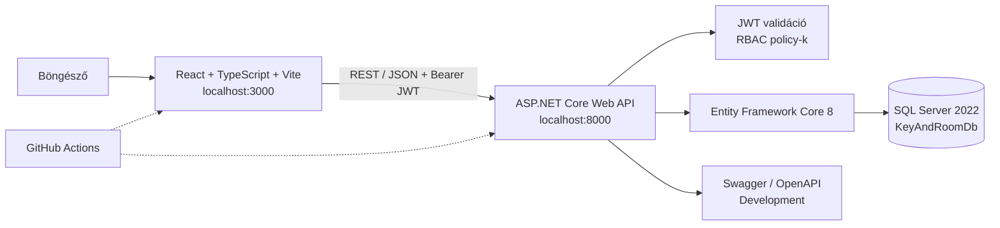
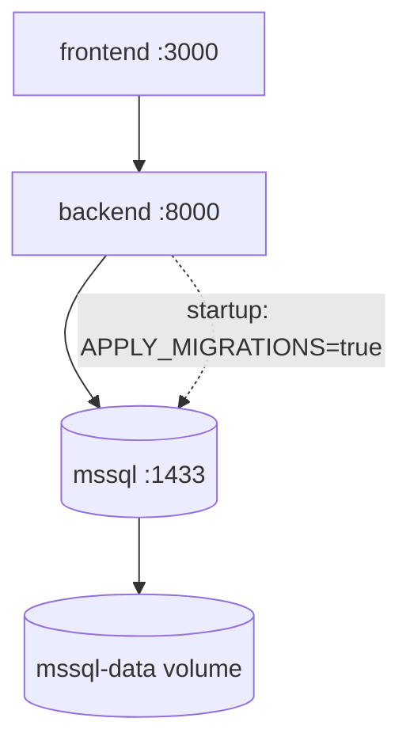
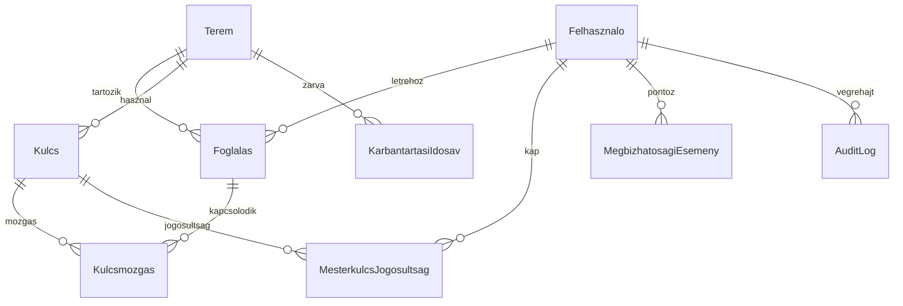

# Egyetemi kulcs- és teremnyilvántartó rendszer

Az alkalmazás egyetemi termek, foglalások, kulcsok és kulcsmozgások központi
nyilvántartására készül. A backend jelenlegi állapota a fő üzleti modulokat,
JWT-alapú hitelesítést, szerepkörös jogosultságkezelést, SQL Server-adatbázist,
riportokat és automatizált teszteket tartalmaz. A frontend még a Vite kezdő
felülete, ezért a rendszer jelenleg backend-központú, integrációs állapotban van.

> **Állapotfelvétel:** 2026. november 2.
> A „kész” jelölés a repositoryban ténylegesen megtalálható és tesztelt
> funkcionalitást jelenti, nem csak a tervben szereplő célt.

A backend jelenlegi állapota JWT-hitelesítést, szerepkör-alapú jogosultságkezelést,
üzleti végpontokat és SQL Server-adatbázis-integrációt tartalmaz. A frontend
jelenleg a Vite kezdőfelülete.

## Technológiai stack

| Réteg | Technológia | Repository-állapot |
|---|---|---|
| Frontend | React 19, TypeScript, Vite 8 | Kezdő Vite-felület, a domain UI még hiányzik |
| Backend | ASP.NET Core Web API, .NET 8 | Kész, endpoint-modulokra bontva |
| Adatbázis | Microsoft SQL Server 2022 | Docker Compose-ban konfigurálva |
| ORM/migráció | Entity Framework Core 8, SQL Server provider | Kész, 3 migráció verziózva |
| Hitelesítés | JWT Bearer, BCrypt.Net-Next | Kész |
| Dokumentáció | Swagger/OpenAPI v1 | Development környezetben elérhető |
| Tesztelés | xUnit, ASP.NET Core test host, EF InMemory | Kész; külön SQL Server teszt is előkészítve |
| CI/CD | GitHub Actions | Backend, frontend és Docker ellenőrzés konfigurálva |

## Architektúra



Docker Compose három szolgáltatást indít közös bridge hálózaton:



## Elkészült backend

### Hitelesítés és rendszer

- `POST /api/auth/login` – felhasználónév/jelszó ellenőrzése és JWT kiadása.
- `POST /api/auth/logout` – kliensoldali token-törléshez visszajelzés.
- `GET /api/auth/me` – aktuális felhasználó adatai.
- `GET /api/health` – API- és adatbázis-kapcsolat ellenőrzése.
- JWT issuer, audience, élettartam és legalább 32 bájtos aláírókulcs validálása.
- Üres adatbázisnál opcionális, egyszeri admin bootstrap BCrypt jelszóhash-sel.
- `Adminisztrator`, `Portas`, `Oktato`, `UzemeltetesiIgazgato` szerepkörök és
  ezekre épülő policy-k.

### Üzleti végpontok

| Modul | Végpontok | Állapot |
|---|---|---|
| Felhasználók | `/api/users` | Kész, adminisztrátori CRUD és szerepkörmódosítás |
| Termek | `/api/rooms` | Kész, CRUD, elérhetőség és teremhez tartozó kulcsok |
| Kulcsok | `/api/keys` | Kész, CRUD, státusz és mozgáslista |
| Mesterkulcs-jogosultság | `/api/keys/{id}/master-access` | Kész, admin grant/revoke és egyediségvédelem |
| Foglalások | `/api/bookings` | Kész, saját/listázás, CRUD, átfedés- és karbantartás-ellenőrzés |
| Kulcsmozgások | `/api/key-movements` | Kész, kiadás, visszavétel, lista, részlet, overdue |
| Hibajegyek | `/api/tickets` | Kész, létrehozás, listázás, részlet és státuszkezelés |
| Karbantartás | `/api/maintenance` | Kész, admin CRUD és foglalásütközés-védelem |
| Megbízhatóság | `/api/reliability` | Kész, pontszámok, események és admin korrekció |
| Értesítések | `/api/notifications` | Kész, saját értesítések listázása és olvasottnak jelölése |
| Rendszeradminisztráció | `/api/parameters`, `/api/audit` | Kész, paraméterek és auditnapló lekérdezése/módosítása |
| Riportok | `/api/reports` | Kész, napi/heti, teremkihasználtsági, kulcsforgalmi és megbízhatósági riport |

Az összes végpont részletes kérés-/válaszformátuma és jogosultsága a
[docs/API_DESIGN.md](./docs/API_DESIGN.md) fájlban található. Development
környezetben a Swagger UI a `http://localhost:8000/swagger` címen érhető el.

### Adatmodell és integritás



Az EF Core modell jelenleg 13 entitást tartalmaz: felhasználó, terem, kulcs,
kulcs–terem kapcsolat, mesterkulcs-jogosultság, foglalás, kulcsmozgás,
karbantartási idősáv, hibajegy, értesítés, megbízhatósági esemény, auditnapló
és rendszerparaméter. A `SaveChanges` foglalás-átfedést és karbantartási
ütközést ellenőriz; a felhasználónév, e-mail és mesterkulcs-hozzáférés egyedi.

## Üzleti szabályok, amelyek már a backendben vannak

- A foglalási idők egy napon belül, 08:00–20:00 között, 45 perces rácson
  és 45 perces egységekben validálódnak.
- Aktív foglalások nem fedhetik egymást; `Megszuntetve` és `NoShow` nem blokkol.
- Karbantartási idősávval átfedő foglalás nem menthető.
- A megbízhatósági események az aktuális tanévben 0–100 közé korlátozott
  pontszámot adnak, az előzmények és auditbejegyzések megmaradnak.
- A szerepkörök és a védett műveletek backend oldalon is ellenőrzöttek.
- A rendszerparaméterek és adminisztrátori korrekciók auditálódnak.

## Fejlesztési állapot és további feladatok

| Tétel | Jelenlegi állapot | Következő munka |
|---|---|---|
| Frontend domainfelület | Vite starter képernyő látható | Login, szerepkörös navigáció és üzleti oldalak elkészítése |
| Foglalás vége előtti értesítés | Backend oldali háttérfeldolgozás és értesítési API elérhető | Frontend megjelenítés és kézbesítési csatorna |
| Automatikus no-show feldolgozás | Idempotens háttérfeldolgozás elérhető | Üzemeltetési megfigyelhetőség |
| Napi kulcszárás | Háttérfeldolgozás elérhető | Üzemeltetési megfigyelhetőség |
| Értesítési csatorna | In-app értesítések érhetők el az API-n keresztül; e-mail/push kézbesítés nincs | Kézbesítési stratégia és konfiguráció |
| Production üzemeltetés | Compose fejlesztési/teszt futtatásra alkalmas | HTTPS, szűkített CORS, titokkezelés, monitoring és backup |
| Swagger elérhetőség | Csak Development környezetben | Tudatos production policy és publikált API-specifikáció |
| `/weatherforecast` | Template maradvány végpont | Törlés a backend takarításakor |

## Indítás

### Docker Compose

```bash
cp .env.example .env
```

Windows PowerShell alatt:

```powershell
Copy-Item .env.example .env
```

A tényleges változóneveket és a kötelező értékeket a `.env.example` és a `docker-compose.yml` határozza meg. A `.env` fájlt ne töltsd fel a Git repositoryba, és valódi jelszót, tokent vagy egyéb titkot ne commitolj.

A Docker Compose az `ASPNETCORE_ENVIRONMENT` változó hiányában `Production` környezetben indítja a backendet. Cseréld le az `.env.example` helyőrzőit az `.env` fájlban egyedi `MSSQL_SA_PASSWORD`, `JWT_ISSUER`, `JWT_AUDIENCE` és `JWT_SIGNING_KEY` értékekre. A JWT-aláírókulcs legalább 32 bájt legyen; például `openssl rand -base64 48` paranccsal állíthatsz elő véletlen értéket. A példafájlban lévő értékek csak helyőrzők, éles környezetben nem használhatók; hiányzó vagy rövid kulccsal az alkalmazás nem indul el.

Helyi fejlesztéshez `ASPNETCORE_ENVIRONMENT=Development` használható. Ebben a környezetben a [backend/appsettings.Development.json](./backend/appsettings.Development.json) tartalmaz egy kizárólag fejlesztéshez használható JWT-kulcsot; ezt az értéket éles környezetben tilos használni. Az `appsettings.json` nem tartalmaz aláírókulcsot.

### Első indítás: adminisztrátor inicializálása

Üres adatbázis esetén a migrációk után a backend egyetlen adminisztrátori fiókot hoz létre a `BOOTSTRAP_ADMIN_USERNAME` és `BOOTSTRAP_ADMIN_PASSWORD` változók alapján. A felhasználónév 3–50 ASCII betű, szám, pont, aláhúzás vagy kötőjel lehet; a jelszó legalább 12, legfeljebb 72 UTF-8 bájt legyen. A jelszó BCrypt hash-ként kerül mentésre. Hiányos vagy érvénytelen inicializáló adatokkal az üres adatbázisú alkalmazás egyértelmű hibával leáll.

Az inicializálás csak akkor történik meg, ha az adatbázisban még nincs felhasználó. Az első sikeres indulás után vedd ki a bootstrap felhasználónevet és jelszót a `.env` fájlból, és ne tárold őket forráskódban vagy más nem biztonságos helyen. Nincs nyilvános admin-létrehozó API; a bejelentkezés a `POST /api/auth/login` végponton történik.

A JWT `sub` claimje az adatbázisbeli felhasználóazonosító, a `role` claim pedig az alábbi kanonikus értékek egyike legyen: `Oktato`, `Portas`, `Adminisztrator`, `UzemeltetesiIgazgato`.

A szerepkörneveket normalizáló migráció a korábban eltárolt értékeket ezekre a kanonikus ASCII értékekre alakítja át; a fiókok egyéb adatait nem módosítja.

## Indítás Docker Compose segítségével

A repository gyökérkönyvtárában futtasd:

```bash
# töltsd ki egyedi MSSQL-, JWT- és szükség esetén bootstrap-admin értékekkel
docker compose up --build -d
docker compose ps
curl http://localhost:8000/api/health
```

Leállítás:

```bash
docker compose down
```

A `mssql-data` volume megőrzéséhez ne használd a `docker compose down -v`
parancsot. A kötelező és opcionális környezeti változókat az
[.env.example](./.env.example) és a [docker-compose.yml](./docker-compose.yml)
határozza meg.

### Helyi fejlesztés

#### Demo-fiókok a bemutatóhoz

Az `.env` fájlban állíts be négy külön, erős jelszót, majd kifejezetten
kapcsold be a demo-fiókok létrehozását:

```dotenv
BOOTSTRAP_DEMO_USERS_ENABLED=true
DEMO_OKTATO_USERNAME=demo.oktato
DEMO_OKTATO_PASSWORD=<egyedi, legalább 12 karakteres jelszó>
DEMO_PORTAS_USERNAME=demo.portas
DEMO_PORTAS_PASSWORD=<egyedi, legalább 12 karakteres jelszó>
DEMO_ADMIN_USERNAME=demo.admin
DEMO_ADMIN_PASSWORD=<egyedi, legalább 12 karakteres jelszó>
DEMO_IGAZGATO_USERNAME=demo.igazgato
DEMO_IGAZGATO_PASSWORD=<egyedi, legalább 12 karakteres jelszó>
```

Ezután indítsd újra a backendet (például `docker compose up --build -d
backend`). A bootstrap kizárólag engedélyezéskor fut, mind a négy fiók
konfigurációját megköveteli, a jelszavakat BCrypt hash-ként tárolja, és
felhasználónévütközés esetén a meglévő fiókot változatlanul hagyja. A
bootstrap nem ír jelszót a naplóba vagy a forráskódba. A jelszavak legfeljebb
72 UTF-8 bájtosak legyenek. A jelszavakat ne használd újra valódi fiókoknál.

A jelenlegi fejlesztői Compose-beállításban rögzített portkiosztás:

| Szolgáltatás | Gazdagépen elérhető port | Konténerport | Megjegyzés |
|---|---:|---:|---|
| Frontend | `3000` | `3000` | Böngészőből: `http://localhost:3000` |
| Backend API | `8000` | `8000` | Az API gazdagépről: `http://localhost:8000` |
| Microsoft SQL Server | `1433` | `1433` | Adatbázis-kapcsolathoz; a hitelesítési adatokat a `.env` tartalmazza |

A portok a `docker-compose.yml` fájlban ellenőrizhetők. Ha ott változnak, ezt a táblázatot is frissíteni kell.

## API-ellenőrzés

A backend az alábbi ellenőrző és adatlekérdező végpontokat biztosítja:

### 1. Egészségellenőrzés (Health Check)

```text
GET http://localhost:8000/api/health
```

- **Sikeres válasz (HTTP 200 OK):**
```json
{
  "status": "ok",
  "database": "connected"
}
```
- **Hiba esetén (HTTP 503 Service Unavailable):**
```json
{
  "status": "unhealthy",
  "database": "disconnected"
}
```

### 2. Termek listázása (Rooms Query)

```text
GET http://localhost:8000/api/rooms
```

- **Válasz (HTTP 200 OK):** Termek listája DTO formátumban (üres lista, ha még nincs rögzített terem):
```json
[
  {
    "id": 1,
    "nev": "I. előadó",
    "kapacitas": 120,
    "leiras": "Főépület 1. emelet",
    "aktivalva": true
  }
]
```

### 3. Egy adott terem lekérdezése

```text
GET http://localhost:8000/api/rooms/{id}
```

- **Sikeres válasz (HTTP 200 OK):** A kiválasztott terem DTO adatai.
- **Ha nem található (HTTP 404 Not Found):** `{"message": "A(z) {id} azonosítójú terem nem található."}`

### Mesterkulcs-jogosultságok

A jogosultságok kezeléséhez hitelesített, `Adminisztrator` szerepkörű felhasználó szükséges. A POST-kérés JSON-törzse:

```json
{ "userId": 123 }
```

| Metódus | Útvonal | Művelet |
|---|---|---|
| `GET` | `/api/keys/{id}/master-access` | A mesterkulcshoz jogosult oktatók listázása |
| `POST` | `/api/keys/{id}/master-access` | Jogosultság adása egy oktatónak |
| `DELETE` | `/api/keys/{id}/master-access/{userId}` | Jogosultság visszavonása |

A végpontok csak `Mesterkulcs` típusú kulcsot fogadnak el; hozzárendeléskor a megadott felhasználónak `Oktato` szerepkörűnek kell lennie.

## Karbantartási idősávok API

- `GET /api/maintenance?teremId=1&startTime=2026-11-02T08:00:00Z&endTime=2026-11-02T18:00:00Z` – idősávok listázása; minden szűrő opcionális, az időtartomány az átfedő idősávokat adja vissza.
- `GET /api/maintenance/{id}` – idősáv részletei.
- `POST /api/maintenance` – új idősáv rögzítése.
- `PUT /api/maintenance/{id}` – idősáv módosítása.
- `DELETE /api/maintenance/{id}` – idősáv törlése.

A karbantartási listázás és részletezés hitelesítést igényel, a létrehozás, módosítás és törlés pedig kizárólag `Adminisztrator` jogosultságú, adatbázisban is megfelelő szerepkörrel rendelkező felhasználónak engedélyezett. A létrehozási és módosítási kérések törzse: `teremId`, `startTime`, `endTime`, valamint opcionálisan `leiras`. A foglalással ütköző idősáv `409 Conflict` választ eredményez; a megszüntetett foglalások nem blokkolják a karbantartást.

## Megbízhatósági pontozás API

- `GET /api/reliability/users/{userId}` – az oktató aktuális tanévi pontszáma (0–100), valamint az aktuális következmény.
- `GET /api/reliability/users/{userId}/events` – az oktató összes pontozási eseménye, beleértve a korábbi tanévek előzményeit.
- `GET /api/reliability/my` – a bejelentkezett oktató saját aktuális tanévi pontszáma.
- `POST /api/reliability/correction` – adminisztrátori pontkorrekció; törzse: `userId`, `pont` (nullától eltérő egész szám, negatív korrekció is lehetséges) és kötelező, legfeljebb 500 karakteres `indoklas`.

A pontszámot a backend az eseményekből, időrendi sorrendben számítja, és minden esemény után 0–100 közé korlátozza. A tanév szeptember 1-jén kezdődik; a korábbi tanévek eseményei és auditbejegyzései megmaradnak. A 10–19 pontos érték figyelmeztetést, a 20–29 pontos kötelező elbeszélgetést, a 30 vagy több pont elbeszélgetést és kulcskezelési/biztonsági tréninget jelent. Az oktató csak a saját adatait kérheti le, az adminisztrátor és az üzemeltetési igazgató más oktató adatait is megtekintheti. A korrekció csak adatbázisban is adminisztrátori szerepkörű felhasználónak engedélyezett; a pontozási esemény és az auditbejegyzés egy tranzakcióban kerül mentésre.

## Adatbázis és migrációk

Az adatbázis sémáját Entity Framework Core migrációk verziózzák (`backend/Migrations`).
A kezdeti migráció neve: `InitialCreate`.

### Build és tesztelés

```bash
dotnet build ProjektLabor.sln --configuration Release
dotnet test ProjektLabor.sln --configuration Release \
  --filter "FullyQualifiedName!~SqlServerIntegrationTests"

cd frontend
npm ci
npm run lint
npm run build
```

Az SQL Server-integrációs tesztet csak külön, eldobható tesztadatbázissal
futtasd a `SQLSERVER_TEST_CONNECTION` változó megadásával; a teszt a megadott
adatbázisra futtatja a migrációkat, majd a demo-bootstrapot, BCrypt-hasheket
és mind a négy szerepkör hitelesítését ellenőrzi. A normál CI ezt a tesztet
szándékosan kihagyja. Példa:

```bash
SQLSERVER_TEST_CONNECTION='Server=localhost,1433;Database=DisposableProjektLaborTest;User Id=sa;Password=<tesztjelszó>;TrustServerCertificate=True' \
  dotnet test backend.Tests/backend.Tests.csproj --configuration Release \
  --filter "FullyQualifiedName~SqlServerIntegrationTests"
```

Az adatbázis legyen külön erre a célra létrehozott és eldobható; a teszt nem
törli az adatbázist. A normál CI ezt a tesztet szándékosan kihagyja.

## CI

A [CI workflow](./.github/workflows/ci.yml) `main` push és pull request esetén:

1. restore/build/test futtat a backendre,
2. lintet és buildet futtat a frontendben,
3. validálja a Compose konfigurációt és megkísérli a Docker buildet.

## Kapcsolódó dokumentumok

## Fejlesztési konvenciók

A módosításokat külön brancheken készítsétek, majd Pull Requesten keresztül integráljátok a `main` ágba. A projektben használt commitprefixek:

- `feat:` – új funkció
- `fix:` – hibajavítás
- `refactor:` – belső átszervezés
- `test:` – tesztek hozzáadása vagy módosítása
- `docs:` – dokumentáció

A változtatás legyen kicsi, célzott, és a Pull Request írja le a módosítás célját, a tesztelés eredményét, illetve az esetleges ismert korlátokat.

## Megvalósított funkciók és további terv

- A backend megvalósítja a terem-, kulcs-, foglalás-, kulcsmozgás-, hibajegy-,
  karbantartási, megbízhatósági, rendszeradminisztrációs és riport-végpontokat.
- JWT-hitelesítés, kanonikus szerepkörök és endpoint-szintű RBAC-policyk
  védik a backend műveleteit.
- A foglalási végpontok ellenőrzik az időintervallumot, a terem állapotát,
  valamint a foglalási és karbantartási ütközéseket.
- A kulcsmozgásokhoz auditnaplózás és az adatbázisban tranzakciós zárolás
  tartozik.
- A frontend jelenleg Vite kezdőfelület; a domain felhasználói felület és az
  értesítések felhasználói megjelenítése további fejlesztési terület.

## Ismert korlátok / frissítendő adatok

A README-t a repository tényleges állapotával együtt kell karbantartani. Az API pontos adatlekérdező útvonalát, az alkalmazott .NET-verziót, az EF Core provider/verziót, a migrációk futtatásának pontos módját és a CI workflow fájlnevét csak akkor szabad konkrét értékként feltüntetni, ha azokat a kódbázisban ellenőriztük.
- [Projektterv és megvalósítási állapot](./projektterv.md)
- [API-tervezési dokumentáció](./docs/API_DESIGN.md)
- [Adatbázis- és migrációs megjegyzések](./database/README.md)
