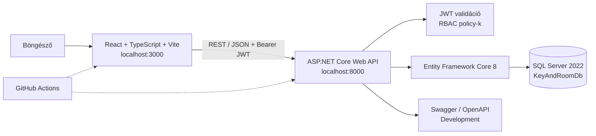
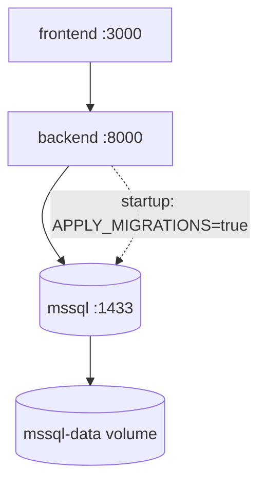
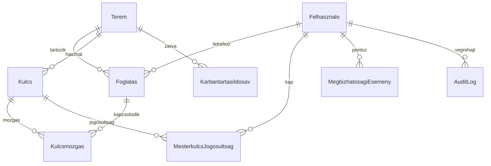

# Egyetemi kulcs- és teremnyilvántartó rendszer

Az alkalmazás egyetemi termek, foglalások, kulcsok és kulcsmozgások központi
nyilvántartására készül. A backend jelenlegi állapota a fő üzleti modulokat,
JWT-alapú hitelesítést, szerepkörös jogosultságkezelést, SQL Server-adatbázist,
riportokat és automatizált teszteket tartalmaz. A frontend még a Vite kezdő
felülete, ezért a rendszer jelenleg backend-központú, integrációs állapotban van.

> **Állapotfelvétel:** 2026. november 2.
> A „kész” jelölés a repositoryban ténylegesen megtalálható és tesztelt
> funkcionalitást jelenti, nem csak a tervben szereplő célt.

## Technológiai stack

| Réteg | Technológia | Repository-állapot |
|---|---|---|
| Frontend | React 19, TypeScript, Vite 8 | Kezdő Vite-felület, a domain UI még hiányzik |
| Backend | ASP.NET Core Web API, .NET 8 | Kész, endpoint-modulokra bontva |
| Adatbázis | Microsoft SQL Server 2022 | Docker Compose-ban konfigurálva |
| ORM/migráció | Entity Framework Core 8, SQL Server provider | Kész, 3 migráció verziózva |
| Hitelesítés | JWT Bearer, BCrypt.Net-Next | Kész |
| Dokumentáció | Swagger/OpenAPI v1 | Development környezetben elérhető |
| Tesztelés | xUnit, ASP.NET Core test host, EF InMemory | Kész; külön SQL Server teszt is előkészítve |
| CI/CD | GitHub Actions | Backend, frontend és Docker ellenőrzés konfigurálva |

## Architektúra



Docker Compose három szolgáltatást indít közös bridge hálózaton:



## Elkészült backend

### Hitelesítés és rendszer

- `POST /api/auth/login` – felhasználónév/jelszó ellenőrzése és JWT kiadása.
- `POST /api/auth/logout` – kliensoldali token-törléshez visszajelzés.
- `GET /api/auth/me` – aktuális felhasználó adatai.
- `GET /api/health` – API- és adatbázis-kapcsolat ellenőrzése.
- JWT issuer, audience, élettartam és legalább 32 bájtos aláírókulcs validálása.
- Üres adatbázisnál opcionális, egyszeri admin bootstrap BCrypt jelszóhash-sel.
- `Adminisztrator`, `Portas`, `Oktato`, `UzemeltetesiIgazgato` szerepkörök és
  ezekre épülő policy-k.

### Üzleti végpontok

| Modul | Végpontok | Állapot |
|---|---|---|
| Felhasználók | `/api/users` | Kész, adminisztrátori CRUD és szerepkörmódosítás |
| Termek | `/api/rooms` | Kész, CRUD, elérhetőség és teremhez tartozó kulcsok |
| Kulcsok | `/api/keys` | Kész, CRUD, státusz és mozgáslista |
| Mesterkulcs-jogosultság | `/api/keys/{id}/master-access` | Kész, admin grant/revoke és egyediségvédelem |
| Foglalások | `/api/bookings` | Kész, saját/listázás, CRUD, átfedés- és karbantartás-ellenőrzés |
| Kulcsmozgások | `/api/key-movements` | Kész, kiadás, visszavétel, lista, részlet, overdue |
| Hibajegyek | `/api/tickets` | Kész, létrehozás, listázás, részlet és státuszkezelés |
| Karbantartás | `/api/maintenance` | Kész, admin CRUD és foglalásütközés-védelem |
| Megbízhatóság | `/api/reliability` | Kész, pontszámok, események és admin korrekció |
| Rendszeradminisztráció | `/api/parameters`, `/api/audit` | Kész, paraméterek és auditnapló lekérdezése/módosítása |
| Riportok | `/api/reports` | Kész, napi/heti, teremkihasználtsági, kulcsforgalmi és megbízhatósági riport |

Az összes végpont részletes kérés-/válaszformátuma és jogosultsága a
[docs/API_DESIGN.md](./docs/API_DESIGN.md) fájlban található. Development
környezetben a Swagger UI a `http://localhost:8000/swagger` címen érhető el.

### Adatmodell és integritás



Az EF Core modell jelenleg 13 entitást tartalmaz: felhasználó, terem, kulcs,
kulcs–terem kapcsolat, mesterkulcs-jogosultság, foglalás, kulcsmozgás,
karbantartási idősáv, hibajegy, értesítés, megbízhatósági esemény, auditnapló
és rendszerparaméter. A `SaveChanges` foglalás-átfedést és karbantartási
ütközést ellenőriz; a felhasználónév, e-mail és mesterkulcs-hozzáférés egyedi.

## Üzleti szabályok, amelyek már a backendben vannak

- A foglalási idők egy napon belül, 08:00–20:00 között, 45 perces rácson
  és 45 perces egységekben validálódnak.
- Aktív foglalások nem fedhetik egymást; `Megszuntetve` és `NoShow` nem blokkol.
- Karbantartási idősávval átfedő foglalás nem menthető.
- A megbízhatósági események az aktuális tanévben 0–100 közé korlátozott
  pontszámot adnak, az előzmények és auditbejegyzések megmaradnak.
- A szerepkörök és a védett műveletek backend oldalon is ellenőrzöttek.
- A rendszerparaméterek és adminisztrátori korrekciók auditálódnak.

## Mi hiányzik vagy nincs még teljesen bekötve?

| Tétel | Jelenlegi állapot | Következő munka |
|---|---|---|
| Frontend domainfelület | Vite starter képernyő látható | Login, szerepkörös navigáció és üzleti oldalak elkészítése |
| Foglalás vége előtti értesítés | `Ertesites` entitás létezik, de nincs generáló worker/endpoint | Background service, küldési állapot és frontend megjelenítés |
| Automatikus no-show feldolgozás | `NoShow` státusz és paraméter létezik, időzített feldolgozó nincs | Ütemezett job, idempotens státuszváltás és tesztek |
| Értesítési csatorna | Nincs e-mail/push/in-app kézbesítő | Kézbesítési stratégia és konfiguráció |
| Production üzemeltetés | Compose fejlesztési/teszt futtatásra alkalmas | HTTPS, szűkített CORS, titokkezelés, monitoring és backup |
| Swagger elérhetőség | Csak Development környezetben | Tudatos production policy és publikált API-specifikáció |
| `/weatherforecast` | Template maradvány végpont | Törlés a backend takarításakor |

## Indítás

### Docker Compose

```bash
cp .env.example .env
# töltsd ki egyedi MSSQL-, JWT- és szükség esetén bootstrap-admin értékekkel
docker compose up --build -d
docker compose ps
curl http://localhost:8000/api/health
```

Leállítás:

```bash
docker compose down
```

A `mssql-data` volume megőrzéséhez ne használd a `docker compose down -v`
parancsot. A kötelező és opcionális környezeti változókat az
[.env.example](./.env.example) és a [docker-compose.yml](./docker-compose.yml)
határozza meg.

### Helyi fejlesztés

```bash
dotnet build ProjektLabor.sln --configuration Release
dotnet test ProjektLabor.sln --configuration Release \
  --filter "FullyQualifiedName!~SqlServerIntegrationTests"

cd frontend
npm ci
npm run lint
npm run build
```

Az SQL Server-integrációs tesztet csak külön, eldobható tesztadatbázissal
futtasd a `SQLSERVER_TEST_CONNECTION` változó megadásával. A normál CI ezt a
tesztet szándékosan kihagyja.

## CI

A [CI workflow](./.github/workflows/ci.yml) `main` push és pull request esetén:

1. restore/build/test futtat a backendre,
2. lintet és buildet futtat a frontendben,
3. validálja a Compose konfigurációt és megkísérli a Docker buildet.

## Kapcsolódó dokumentumok

- [Projektterv és megvalósítási állapot](./projektterv.md)
- [API-tervezési dokumentáció](./docs/API_DESIGN.md)
- [Adatbázis- és migrációs megjegyzések](./database/README.md)
