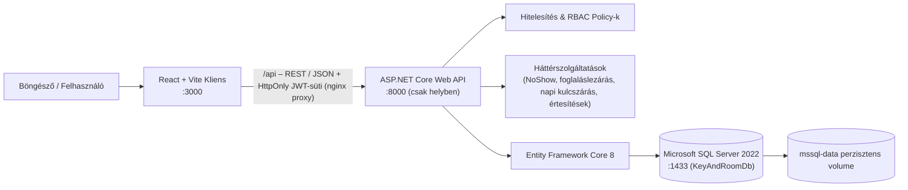

# Egyetemi Kulcs- és Teremnyilvántartó Rendszer (ProjektLabor)

Egyetemi termek, teremfoglalások, fizikai kulcsok és kulcsmozgások teljes körű, szerepkör-alapú nyilvántartó és menedzsment rendszere.

---

## Főbb funkciók és szerepkörök

A rendszer négy jól elkülönülő szerepkört támogat, mindegyikhez dedikált jogosultságokkal és felülettel:

| Szerepkör | Fő felelősségi kör | Elérhető funkciók |
| :--- | :--- | :--- |
| **`Oktato`** | Foglalások és kulcshasználat | Teremkatalógus böngészése, új foglalás leadása, saját foglalások, megbízhatósági hibapont és rendszerbeli értesítések megtekintése, hibajegy bejelentése. |
| **`Portas`** | Kulcsok fizikai kiadása és visszavétele | Kulcsok kiadása/visszavétele az átvevő PIN-jével (a kiadás magától az esedékes foglaláshoz kötődik), kint lévő és lejárt kulcsok, kulcsmozgások naplója, esti kulcsvisszavételi értesítések, hibajegy rögzítése. |
| **`Adminisztrator`** | Rendszertörzsadatok és konfiguráció | Felhasználók kezelése (inaktiválás/újraaktiválás, szerepkör, PIN), termek és kulcsok kezelése, mesterkulcs-jogosultságok, karbantartási idősávok, hibajegy-státuszok, rendszerparaméterek, megbízhatósági korrekció, auditnapló. |
| **`UzemeltetesiIgazgato`** | Ellenőrzés és riportálás | Teremkihasználtsági statisztikák, napi és heti riportok, kulcsforgalom elemzése, oktatói megbízhatósági audit, teljes rendszeresemény-napló. |

---

## Technológiai stack

| Réteg | Technológia | Megjegyzés |
| :--- | :--- | :--- |
| **Frontend** | React 19, TypeScript, Vite, saját CSS, Lucide React | Szerepkörös SPA; élesben nginx szolgálja ki, és az `/api` kéréseket a backendre továbbítja. |
| **Backend** | ASP.NET Core 10 Minimal API, C# | Erősen típusos, moduláris végpontok, BCrypt jelszó- és kulcsátvételi PIN-kezelés, beépített RBAC házirendek. |
| **Adatbázis** | Microsoft SQL Server 2022 | Konténerizált relációs adatbázis tranzakció- és zárkezeléssel. |
| **ORM / Migráció** | Entity Framework Core 8 | Code-first megközelítés, automatikus séma-migrációk indításkor. |
| **Hitelesítés** | JSON Web Token HttpOnly sütiben + BCrypt | A token JavaScriptből nem olvasható; minden kérésnél adatbázis-ellenőrzés (aktív felhasználó, egyező szerepkör), bejelentkezési kéréskorlát, PIN-zárolás. |
| **Dokumentáció** | Swagger / OpenAPI v1 | Fejlesztői módban interaktív tesztelő felület (`/swagger`). |
| **Tesztelés & CI** | xUnit, WebApplicationFactory, Vitest, GitHub Actions | 198 backend teszt (valódi SQL Serveren is) és 52 frontend teszt, linting, Docker-build ellenőrzés. |

---

## Rendszerarchitektúra



---

## Adatbázis ER-modell

```mermaid
erDiagram

    FELHASZNALOK {
        int Id PK
        string Username UK
        string Email UK
        string JelszoHash
        string PinHash
        string Nev
        string Role
        boolean Aktiv
        int PinHibasProbalkozasok
        datetime PinZarolvaEddig
        datetime CreatedAt
        datetime UpdatedAt
    }

    TERMEK {
        int Id PK
        string Nev
        int Kapacitas
        string Leiras
        string Felszereltseg
        boolean Aktivalva
    }

    KULCSOK {
        int Id PK
        int TeremId FK
        string Szam UK
        string Tipus
        boolean Aktivalva
    }

    KULCSTEREM {
        int KulcsId PK, FK
        int TeremId PK, FK
    }

    MESTERKULCS_JOGOSULTSAGOK {
        int Id PK
        int KulcsId FK
        int FelhasznaloId FK
    }

    FOGLALASOK {
        int Id PK
        int FelhasznaloId FK
        int TeremId FK
        datetime StartTime
        datetime EndTime
        string Status
        string SpecialisIgenyek
    }

    KULCSMOZGASOK {
        int Id PK
        int KulcsId FK
        int? FoglalasId FK
        int? AtvevoFelhasznaloId FK
        int? TeremId "a kiadás terme"
        int OperatorId FK
        string MozgasTipus
        datetime Idopont
        string Megjegyzes
        string TeremAllapot
        string SerulesLeiras
    }

    KARBANTARTASI_IDOSAVOK {
        int Id PK
        int TeremId FK
        int FelhasznaloId FK
        datetime StartTime
        datetime EndTime
        string Leiras
    }

    HIBAJEGYEK {
        int Id PK
        int TeremId FK
        int FelhasznaloId FK
        string Kategoria
        string Leiras
        string Statusz
    }

    MEGBIZHATOSAGI_ESEMENYEK {
        int Id PK
        int FelhasznaloId FK
        int KulcsId FK
        int FoglalasId FK
        int KiadasiKulcsmozgasId FK
        int LetrehozoFelhasznaloId FK
        string EsemenyTipus
        int Pont
        boolean Automatikus
        datetime EredetiHatarido
        datetime TenylegesLeadasIdeje
    }

    AUDIT_LOGOK {
        int Id PK
        int FelhasznaloId FK
        string MuveletTipus
        string EntitasTipus
        string EntitasId
        string AutomationKey
        string RegiErtek
        string UjErtek
        string Indoklas
        datetime LetrehozasIdeje
    }

    ERTESITESEK {
        int Id PK
        int FoglalasId FK "nullable"
        int CimzettFelhasznaloId FK "nullable"
        int KulcsmozgasId FK "nullable"
        string ErtesitesTipus
        datetime IdoPont
        datetime Hatarido "nullable"
        string Allapot
        boolean Olvasva
        string AutomationKey
        datetime CreatedAt
    }

    RENDSZERPARAMETEREK {
        string Kulcs PK
        string Ertek
        string Leiras
        datetime ModositasIdeje
    }

    %% Felhasznalok es teremfoglalasok
    FELHASZNALOK ||--o{ FOGLALASOK : "letrehozza"
    TERMEK ||--o{ FOGLALASOK : "helyszine"

    %% Termek es kulcsok
    TERMEK ||--o{ KULCSOK : "rendelkezik"

    %% Mesterkulcsok es az altaluk nyithato termek
    KULCSOK ||--o{ KULCSTEREM : "hozzarendeles"
    TERMEK ||--o{ KULCSTEREM : "megnyithato"

    %% Mesterkulcs felveteli jogosultsagok
    KULCSOK ||--o{ MESTERKULCS_JOGOSULTSAGOK : "jogosultsag"
    FELHASZNALOK ||--o{ MESTERKULCS_JOGOSULTSAGOK : "rendelkezik"

    %% Fizikai kulcsmozgások
    KULCSOK ||--o{ KULCSMOZGASOK : "mozgasnaplo"
    FOGLALASOK o|--o{ KULCSMOZGASOK : "kapcsolodo foglalas"
    FELHASZNALOK o|--o{ KULCSMOZGASOK : "atvevo"
    FELHASZNALOK ||--o{ KULCSMOZGASOK : "operator"

    %% Karbantartasi idosavok
    TERMEK ||--o{ KARBANTARTASI_IDOSAVOK : "karbantartas"
    FELHASZNALOK ||--o{ KARBANTARTASI_IDOSAVOK : "rogziti"

    %% Hibajegyek
    TERMEK ||--o{ HIBAJEGYEK : "hibas terem"
    FELHASZNALOK ||--o{ HIBAJEGYEK : "bejelenti"

    %% Megbizhatosagi esemenyek
    FELHASZNALOK ||--o{ MEGBIZHATOSAGI_ESEMENYEK : "erintett felhasznalo"
    KULCSOK o|--o{ MEGBIZHATOSAGI_ESEMENYEK : "erintett kulcs"
    FOGLALASOK o|--o{ MEGBIZHATOSAGI_ESEMENYEK : "kapcsolodo foglalas"
    KULCSMOZGASOK o|--o{ MEGBIZHATOSAGI_ESEMENYEK : "kiadasi mozgas"
    FELHASZNALOK ||--o{ MEGBIZHATOSAGI_ESEMENYEK : "letrehozo"

    %% Audit naplozas
    FELHASZNALOK o|--o{ AUDIT_LOGOK : "muveletet vegzi"
    
    %% Felhasznaloi ertesitesek
    FOGLALASOK o|--o{ ERTESITESEK : "foglalasi ertesites"
    FELHASZNALOK o|--o{ ERTESITESEK : "cimzett"
    KULCSMOZGASOK o|--o{ ERTESITESEK : "kulcsvisszaveteli esemeny"
```

---

## Gyorsindítás (Docker Compose)

### 1. Környezeti változók előkészítése
Másold le a mellékelt minta-fájlt, és állíts be saját, biztonságos jelszavakat:
```bash
cp .env.example .env
```
*(Windows PowerShell esetén: `Copy-Item .env.example .env`)*

A `.env` fájlban add meg a kulcsokat:
- `MSSQL_SA_PASSWORD`: Erős adatbázis rendszergazda jelszó. Csak az SQL Server és az egyszeri `db-init` lépés használja.
- `MSSQL_APP_PASSWORD`: Az alkalmazás saját adatbázis-felhasználójának (`projektlabor_app`) jelszava (legalább 12 karakter, idézőjel nélkül). A `db-init` szolgáltatás induláskor létrehozza ezt a felhasználót, amely csak a `KeyAndRoomDb` adatbázishoz fér hozzá; a backend ezzel csatlakozik, nem az `sa` fiókkal. **Meglévő telepítésnél is fel kell venni a `.env`-be**, különben a `docker compose` nem indul.
- `AUTH_COOKIE_SECURE`: `true`, ha az alkalmazás HTTPS-t lezáró proxy mögött fut (lásd lent). Alapértelmezés: `false`.
- `JWT_SIGNING_KEY`: Legalább 32 bájtos véletlenszerű kulcs (pl. `openssl rand -base64 48`).
- `BOOTSTRAP_ADMIN_USERNAME` és `BOOTSTRAP_ADMIN_PASSWORD`: Az induló adminisztrátori fiók adatai (legalább 12 karakteres jelszó; a `REPLACE_WITH_` mintaértékeket a rendszer elutasítja). Akkor jön létre, ha nincs aktív adminisztrátor.
- `SAMPLE_ACCOUNTS_ENABLED`: `true` esetén a lenti mintafiókok aktívak maradnak (csak bemutatóhoz/fejlesztéshez). Alapértelmezés: `false`.
- *(Opcionális)* `CORS_ALLOWED_ORIGINS`: vesszővel elválasztott originök, ha a frontendet nem a beépített proxyn keresztül éred el.

### Közös kezdő felhasználók

A migrációk minden adatbázisba felveszik az alábbi fiókokat és egy bemutató adatkészletet (`SeedRoleUsersAndReliabilitySample`: `B-101`/`B-102` mintaterem, `MINTA-B101`/`MINTA-B102` kulcs, Rádli Richárd 34 késve visszahozott kulcsa). Ha a mintafiókok nincsenek engedélyezve, a backend induláskor a bemutató adatkészletet is törli, feltéve hogy a mintakulcsokat azóta senki nem használta valódi kiadásra. Mivel a jelszavuk itt nyilvános, **a backend induláskor letiltja azokat, amelyek jelszava még az eredeti**, kivéve ha `SAMPLE_ACCOUNTS_ENABLED=true` (Docker) vagy `SampleAccounts:Enabled=true` (a `Development` környezet `appsettings.Development.json`-ja ezt bekapcsolja). Ha emiatt nem marad aktív adminisztrátor, a `BOOTSTRAP_ADMIN_*` adataiból jön létre egy (az azonos nevű, letiltott mintafiók átvételével).

| Felhasználónév | Jelszó | Szerepkör |
| :--- | :--- | :--- |
| `admin` | `Adminjelszo1!` | Adminisztrátor |
| `oktato` | `Oktatojelszo1!` | Oktató |
| `portas` | `Portasjelszo1!` | Portás |
| `igazgato` | `Igazgatojelszo1!` | Üzemeltetési igazgató |

Az `oktato` fiók kulcsátvételi PIN-je `4729`.
Bemutatóhoz a `.env`-ben állítsd be: `SAMPLE_ACCOUNTS_ENABLED=true`. Éles üzemben hagyd `false`-on. A saját jelszavát minden felhasználó a **Profil → Jelszó módosítása** űrlapon cserélheti le (ilyenkor a más eszközökön nyitva hagyott bejelentkezései megszűnnek); a megváltoztatott jelszavú mintafiókokat a rendszer már nem tiltja le. Az oktatók a kulcsátvételi PIN-kódjukat is maguk állíthatják be a **Profil → Kulcsátvételi PIN-kód** űrlapon; az adminisztrátor a felhasználólistában látja, kinek nincs még PIN-je.

### HTTPS éles üzemben

A konténerek magukban csak HTTP-t szolgálnak ki (a 3000-es porton). Éles üzemben az alkalmazás elé egy
HTTPS-t lezáró reverse proxyt kell tenni (pl. az intézmény meglévő nginx/IIS/Caddy szervere, érvényes
tanúsítvánnyal), amely a kéréseket a `http://<szerver>:3000` címre továbbítja, és beállítja az
`X-Forwarded-Proto: https` fejlécet. Ezután a `.env`-ben állítsd be: `AUTH_COOKIE_SECURE=true` — a
bejelentkezési süti ekkor csak titkosított kapcsolaton utazik. A 3000-es portot ilyenkor ne nyisd meg a
hálózat felé, csak a proxy érje el.

### 2. Alkalmazás indítása konténerben
```bash
docker compose up --build -d
```

Az elindult szolgáltatások ellenőrzése:
```bash
docker compose ps
curl http://localhost:8000/api/health
```

### 3. Elérhetőségek és portok

| Szolgáltatás | Elérési cím | Leírás |
| :--- | :--- | :--- |
| **Frontend UI** | `http://localhost:3000` | Webes felület (nginx szolgálja ki az éles buildet, az `/api` kéréseket továbbítja a backendre) |
| **Backend REST API** | `http://localhost:3000/api` | A frontend proxyján keresztül; közvetlenül (`http://localhost:8000`) csak a saját gépről érhető el |
| **Swagger UI** | `http://localhost:8000/swagger` | API dokumentáció (Development környezetben) |
| **MSSQL Adatbázis** | `localhost:1433` | SQL Server közvetlen elérés (DBeaver, Azure Data Studio stb.), csak a saját gépről |

Leállítás az adatok megőrzésével:
```bash
docker compose down
```

Az adatbázis az induláskor `APPLY_MIGRATIONS=true` beállítással futó backend
által alkalmazza a függő EF Core migrációkat. Meglévő helyi vagy megosztott
adatbázis frissítése előtt készíts és ellenőrizz mentést; a részletes, tizenkilenc
migrációt felsoroló leírást lásd a [database/README.md](./database/README.md)
fájlban. Éles vagy közös adatbázist ne frissíts automatikusan külön jóváhagyás
nélkül.

---

## Helyi fejlesztés és tesztelés

### Backend fejlesztés és tesztek (.NET 10)
A backend .NET 10 (LTS, támogatás 2028 novemberéig) alatt fut; helyi fejlesztéshez a .NET 10 SDK szükséges.
```bash
# Fordítás
dotnet build ProjektLabor.sln

# Adatbázist nem igénylő tesztek
dotnet test ProjektLabor.sln --configuration Release \
  --filter "FullyQualifiedName!~SqlServerIntegrationTests"
```

Az SQL Server-integrációs tesztek kizárólag erre elkülönített teszt SQL
Server-példányon futtathatók. A teszt ideiglenes `ProjektLaborIntegration_*`
adatbázisokat hoz létre és töröl. Ha a `SQLSERVER_TEST_CONNECTION` környezeti
változó nincs beállítva, ezek a tesztek kihagyásra kerülnek (nem buknak el).

### Frontend fejlesztés (Node.js 22+)
```bash
cd frontend
npm ci
npm test
npm run lint
npm run build
```

Az oktató foglalásvége előtti emlékeztetőit a felület az adatbázisban tárolt
értesítésekként jeleníti meg. A napi kulcszárási háttérfolyamat a konfigurált
zárási határidőkor (alapértelmezetten 22:00, `Europe/Budapest`) a még kint lévő
kulcsokhoz az adatbázisban tárolt értesítést hoz létre minden `Portas`
felhasználónak. Az oktatók és portások a `/notifications` felületen olvashatják
értesítéseiket, és olvasottként jelölhetik őket. Az e-mail-, SMS- és push-küldés
nincs bekötve.

---

## Kapcsolódó dokumentációk

- [Projektterv és részletes megvalósítási leírás](./projektterv.md) – célok, üzleti szabályok, komponens-architektúra és roadmap.
- [REST API tervezési dokumentáció](./docs/API_DESIGN.md) – részletes végpont-leírások, kérés- és válaszformátumok (DTO-k).
- [Adatbázis és migrációs segédlet](./database/README.md) – EF Core migrációs parancsok és adatbázis megjegyzések.
