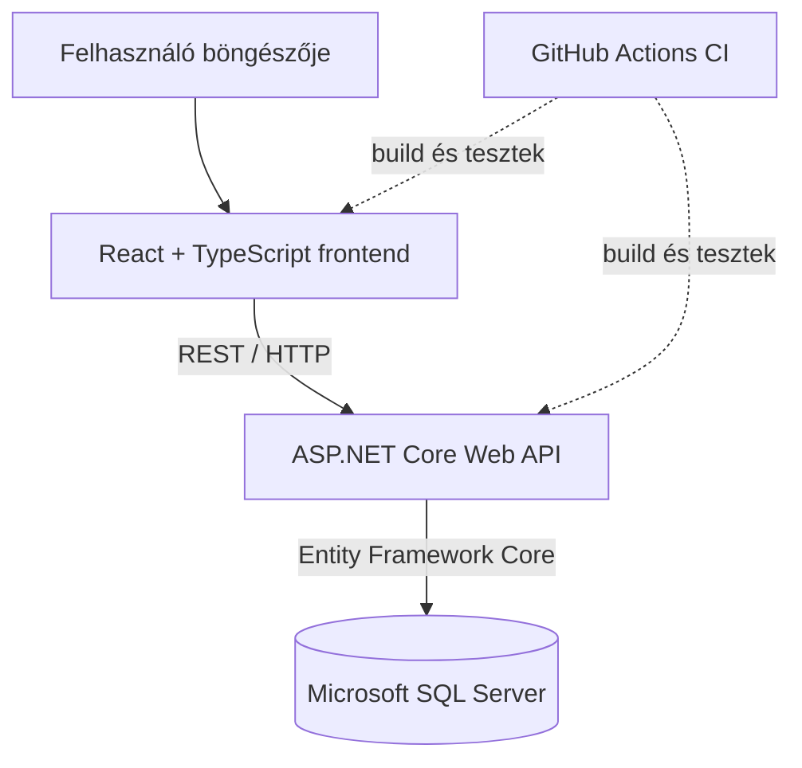

# Egyetemi Kulcs- és Teremnyilvántartó Rendszer

Az alkalmazás célja az egyetemi teremfoglalások, a teremkulcsok kiadásának és visszavételének, valamint az ezekhez kapcsolódó eseményeknek a digitális kezelése.

## Technológiai stack

- **Frontend:** React + TypeScript + Vite
- **Backend:** ASP.NET Core Web API
- **Adatbázis:** Microsoft SQL Server
- **Adatelérés és migrációk:** Entity Framework Core
- **Futtatás:** Docker és Docker Compose
- **Verziókezelés és CI:** GitHub, GitHub Actions

## Rendszerarchitektúra



A frontend az API-n keresztül kommunikál a backenddel. Az adatbázis közvetlenül nem érhető el a böngészőből.

## Előfeltételek

- Git
- Docker Desktop vagy Docker Engine, működő Docker Compose támogatással
- A GitHub repositoryhoz való hozzáférés

A frontend és a backend helyi, konténeren kívüli fejlesztéséhez Node.js/npm, illetve a projektben használt .NET SDK is szükséges lehet. A Dockeres indításhoz ezeket nem feltétlenül kell külön a gazdagépre telepíteni.

## Környezeti változók

A repository gyökerében található `.env.example` fájlból készíts helyi `.env` fájlt, majd töltsd ki a szükséges értékeket:

```bash
cp .env.example .env
```

Windows PowerShell alatt:

```powershell
Copy-Item .env.example .env
```

A tényleges változóneveket és a kötelező értékeket a `.env.example` és a `docker-compose.yml` határozza meg. A `.env` fájlt ne töltsd fel a Git repositoryba, és valódi jelszót, tokent vagy egyéb titkot ne commitolj.

## Indítás Docker Compose segítségével

A repository gyökérkönyvtárában futtasd:

```bash
docker compose up --build -d
```

A szolgáltatások állapotának ellenőrzése:

```bash
docker compose ps
```

A naplók megtekintése:

```bash
docker compose logs -f
```

Egy szolgáltatás naplója külön is lekérhető, például:

```bash
docker compose logs -f backend
docker compose logs -f frontend
docker compose logs -f mssql
```

Leállítás:

```bash
docker compose down
```

A konténerek és az adatbázis tartós adatait tároló volume-ok törlése nem része a szokásos leállításnak. **Ne használd a `docker compose down -v` parancsot, ha meg akarod tartani az adatbázis adatait.**

## Szolgáltatások és portok

A jelenlegi fejlesztői Compose-beállításban rögzített portkiosztás:

| Szolgáltatás | Gazdagépen elérhető port | Konténerport | Megjegyzés |
|---|---:|---:|---|
| Frontend | `3000` | `3000` | Böngészőből: `http://localhost:3000` |
| Backend API | `5000` | `5000` | Az API gazdagépről: `http://localhost:5000` |
| Microsoft SQL Server | `1433` | `1433` | Adatbázis-kapcsolathoz; a hitelesítési adatokat a `.env` tartalmazza |

A portok a `docker-compose.yml` fájlban ellenőrizhetők. Ha ott változnak, ezt a táblázatot is frissíteni kell.

## API-ellenőrzés

A backend az alábbi ellenőrző és adatlekérdező végpontokat biztosítja:

### 1. Egészségellenőrzés (Health Check)

```text
GET http://localhost:5000/api/health
```

- **Sikeres válasz (HTTP 200 OK):**
```json
{
  "status": "ok",
  "database": "connected"
}
```
- **Hiba esetén (HTTP 503 Service Unavailable):**
```json
{
  "status": "unhealthy",
  "database": "disconnected"
}
```

### 2. Termek listázása (Rooms Query)

```text
GET http://localhost:5000/api/rooms
```

- **Válasz (HTTP 200 OK):** Termek listája DTO formátumban (üres lista, ha még nincs rögzített terem):
```json
[
  {
    "id": 1,
    "nev": "I. előadó",
    "kapacitas": 120,
    "leiras": "Főépület 1. emelet",
    "aktivalva": true
  }
]
```

### 3. Egy adott terem lekérdezése

```text
GET http://localhost:5000/api/rooms/{id}
```

- **Sikeres válasz (HTTP 200 OK):** A kiválasztott terem DTO adatai.
- **Ha nem található (HTTP 404 Not Found):** `{"message": "A(z) {id} azonosítójú terem nem található."}`

## Adatbázis és migrációk

Az adatbázis sémáját Entity Framework Core migrációk verziózzák (`backend/Migrations`).
A kezdeti migráció neve: `InitialCreate`.

- **Migrációk futtatása fejlesztői parancssorból:**
```bash
dotnet tool run dotnet-ef database update --project backend
```

- **Automatikus migráció konténer indulásakor:**
A `docker-compose.yml`-ben a `backend` konténer számára az `APPLY_MIGRATIONS=true` környezeti változó van beállítva, így a backend indításakor automatikusan és biztonságosan lefut a `Database.Migrate()` parancs.

## Tesztek és ellenőrzések futtatása

A fejlesztés során és Pull Request benyújtása előtt helyileg is lefuttathatók az ellenőrzések:

### Backend build és tesztek
```bash
dotnet build ProjektLabor.sln
dotnet test ProjektLabor.sln
```

### Frontend lint és build
```bash
cd frontend
npm ci
npm run lint
npm run build
```

### Docker konfiguráció és konténer-buildek ellenőrzése
```bash
docker compose --env-file .env.example config
docker compose --env-file .env.example build
```

## CI – GitHub Actions

A CI-folyamatnak Pull Request nyitásakor és frissítésekor, valamint a `main` ágra történő push/merge után kell lefutnia. Legalább az alábbi lépéseket kell végrehajtania:

1. Repository checkout.
2. Backend restore és build.
3. Backend unit tesztek futtatása.
4. Frontend függőségek telepítése és build.
5. Linter futtatása, amennyiben a projektben konfigurálva van.

A CI állapotát a Pull Requesten kell ellenőrizni. A sikeres helyi futás önmagában nem helyettesíti a GitHub Actions futás ellenőrzését.

## Fejlesztési konvenciók

A módosításokat külön brancheken készítsétek, majd Pull Requesten keresztül integráljátok a `main` ágba. A projektben használt commitprefixek:

- `feat:` – új funkció
- `fix:` – hibajavítás
- `refactor:` – belső átszervezés
- `test:` – tesztek hozzáadása vagy módosítása
- `docs:` – dokumentáció

A változtatás legyen kicsi, célzott, és a Pull Request írja le a módosítás célját, a tesztelés eredményét, illetve az esetleges ismert korlátokat.

## A rendszer tervezett fő moduljai

- Terem- és kulcsnyilvántartás
- Teremfoglalás 45 perces időszeletekkel és ütközésvizsgálattal
- Kulcskiadás és -visszavétel rögzítése
- Hibajegykezelés és karbantartási idősávok
- Felhasználói szerepkörök és jogosultságok (RBAC)
- Auditnapló
- Foglalás vége előtti értesítés
- Oktatói megbízhatósági pontozás
- Napi/heti riportok

Ezek közül a második bemutatóra az infrastruktúra, az első adatbázisséma, a backend–adatbázis kapcsolat, az egészségellenőrző végpont, egy adatlekérdező végpont és legalább egy CI-ban futó unit teszt a prioritás.

## Ismert korlátok / frissítendő adatok

A README-t a repository tényleges állapotával együtt kell karbantartani. Az API pontos adatlekérdező útvonalát, az alkalmazott .NET-verziót, az EF Core provider/verziót, a migrációk futtatásának pontos módját és a CI workflow fájlnevét csak akkor szabad konkrét értékként feltüntetni, ha azokat a kódbázisban ellenőriztük.
