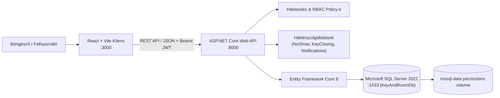
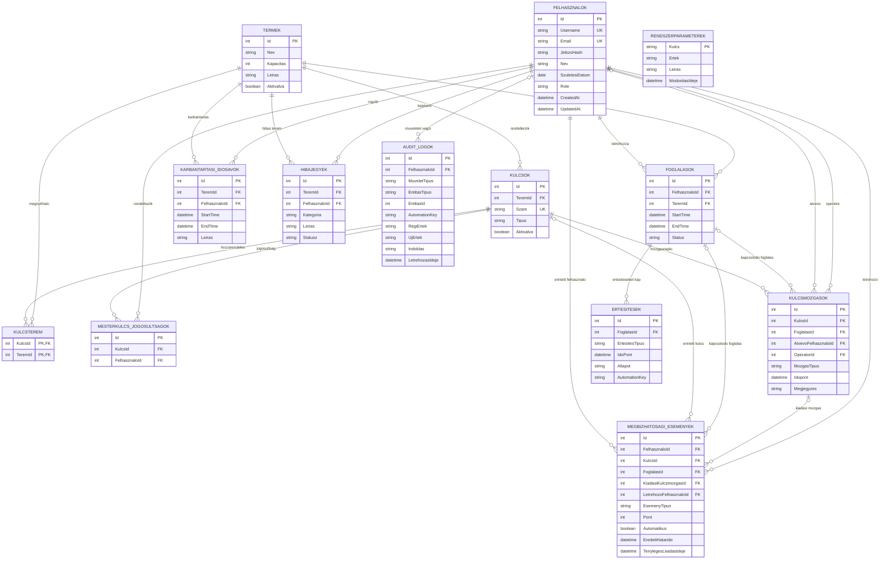

# Egyetemi Kulcs- és Teremnyilvántartó Rendszer (ProjektLabor)

Egyetemi termek, teremfoglalások, fizikai kulcsok és kulcsmozgások teljes körű, szerepkör-alapú nyilvántartó és menedzsment rendszere.

---

## Főbb funkciók és szerepkörök

A rendszer négy jól elkülönülő szerepkört támogat, mindegyikhez dedikált jogosultságokkal és felülettel:

| Szerepkör | Fő felelősségi kör | Elérhető funkciók |
| :--- | :--- | :--- |
| **`Oktato`** | Foglalások és kulcshasználat | Teremkatalógus böngészése, új foglalás leadása, saját foglalások és megbízhatósági pontszám megtekintése, hibajegy bejelentése. |
| **`Portas`** | Kulcsok fizikai kiadása és visszavétele | Aktív foglalásokhoz tartozó kulcsok kiadása/visszavétele, kulcsmozgások naplózása, átvételi elismervény, azonnali hibajegy rögzítés. |
| **`Adminisztrator`** | Rendszertörzsadatok és konfiguráció | Felhasználók kezelése és szerepkör-módosítás, termek és kulcsok CRUD, mesterkulcs-jogosultságok, karbantartási idősávok, rendszerparaméterek, megbízhatósági korrekció. |
| **`UzemeltetesiIgazgato`** | Ellenőrzés és riportálás | Teremkihasználtsági statisztikák, napi és heti riportok, kulcsforgalom elemzése, oktatói megbízhatósági audit, teljes rendszeresemény-napló. |

---

## Technológiai stack

| Réteg | Technológia | Megjegyzés |
| :--- | :--- | :--- |
| **Frontend** | React 19, TypeScript, Vite, Tailwind CSS, Lucide React | Modern SPA szerepkörös irányítópultokkal, JWT klienssel és modális nézetekkel. |
| **Backend** | ASP.NET Core 8 Minimal API, C# | Erősen típusos, moduláris végpontok, BCrypt jelszókezelés, beépített RBAC házirendek. |
| **Adatbázis** | Microsoft SQL Server 2022 | Konténerizált relációs adatbázis tranzakció- és zárkezeléssel. |
| **ORM / Migráció** | Entity Framework Core 8 | Code-first megközelítés, automatikus séma-migrációk indításkor. |
| **Hitelesítés** | JSON Web Token (JWT Bearer) + BCrypt | Állapotmentes, biztonságos token-kezelés claims-alapú szerepkör-ellenőrzéssel. |
| **Dokumentáció** | Swagger / OpenAPI v1 | Fejlesztői módban interaktív tesztelő felület (`/swagger`). |
| **Tesztelés & CI** | xUnit, WebApplicationFactory, GitHub Actions | Unit- és integrációs tesztek, linting, konténerkonfiguráció-ellenőrzés. |

---

## Rendszerarchitektúra



---

## Adatbázis ER-modell



---

## Gyorsindítás (Docker Compose)

### 1. Környezeti változók előkészítése
Másold le a mellékelt minta-fájlt, és állíts be saját, biztonságos jelszavakat:
```bash
cp .env.example .env
```
*(Windows PowerShell esetén: `Copy-Item .env.example .env`)*

A `.env` fájlban add meg a kulcsokat:
- `MSSQL_SA_PASSWORD`: Erős adatbázis rendszergazda jelszó.
- `JWT_SIGNING_KEY`: Legalább 32 bájtos véletlenszerű kulcs (pl. `openssl rand -base64 48`).
- `BOOTSTRAP_ADMIN_USERNAME` és `BOOTSTRAP_ADMIN_PASSWORD`: Az induló adminisztrátori fiók adatai.
- *(Opcionális)* `BOOTSTRAP_DEMO_USERS_ENABLED=true`: Automatikus tesztfelhasználók generálása a 4 szerepkörhöz.

### 2. Alkalmazás indítása konténerben
```bash
docker compose up --build -d
```

Az elindult szolgáltatások ellenőrzése:
```bash
docker compose ps
curl http://localhost:8000/api/health
```

### 3. Elérhetőségek és portok

| Szolgáltatás | Elérési cím | Leírás |
| :--- | :--- | :--- |
| **Frontend UI** | `http://localhost:3000` | Webes felhasználói felület és bejelentkezés |
| **Backend REST API** | `http://localhost:8000` | Fő API kiszolgáló |
| **Swagger UI** | `http://localhost:8000/swagger` | API dokumentáció (Development környezetben) |
| **MSSQL Adatbázis** | `localhost:1433` | SQL Server közvetlen elérés (DBeaver, Azure Data Studio stb.) |

Leállítás az adatok megőrzésével:
```bash
docker compose down
```

---

## Helyi fejlesztés és tesztelés

### Backend fejlesztés és tesztek (.NET 8)
```bash
# Fordítás
dotnet build ProjektLabor.sln

# Automatikus egység- és integrációs tesztek futtatása
dotnet test ProjektLabor.sln --configuration Release \
  --filter "FullyQualifiedName!~SqlServerIntegrationTests"
```

### Frontend fejlesztés (Node.js 20+)
```bash
cd frontend
npm ci
npm run lint
npm run build
```

---

## Kapcsolódó dokumentációk

- [Projektterv és részletes megvalósítási leírás](./projektterv.md) – célok, üzleti szabályok, komponens-architektúra és roadmap.
- [REST API tervezési dokumentáció](./docs/API_DESIGN.md) – részletes végpont-leírások, kérés- és válaszformátumok (DTO-k).
- [Adatbázis és migrációs segédlet](./database/README.md) – EF Core migrációs parancsok és adatbázis megjegyzések.
