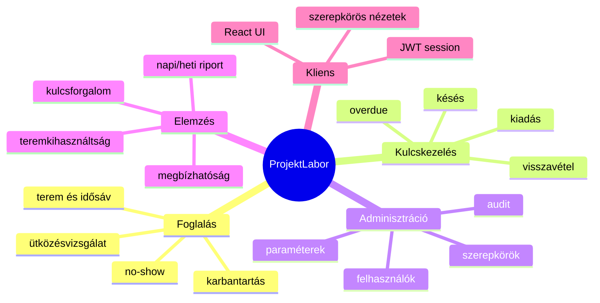
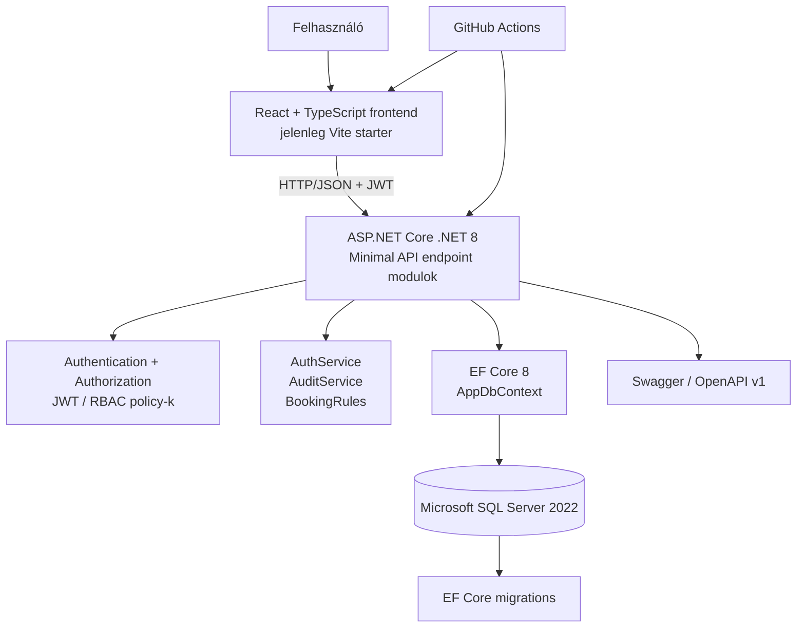
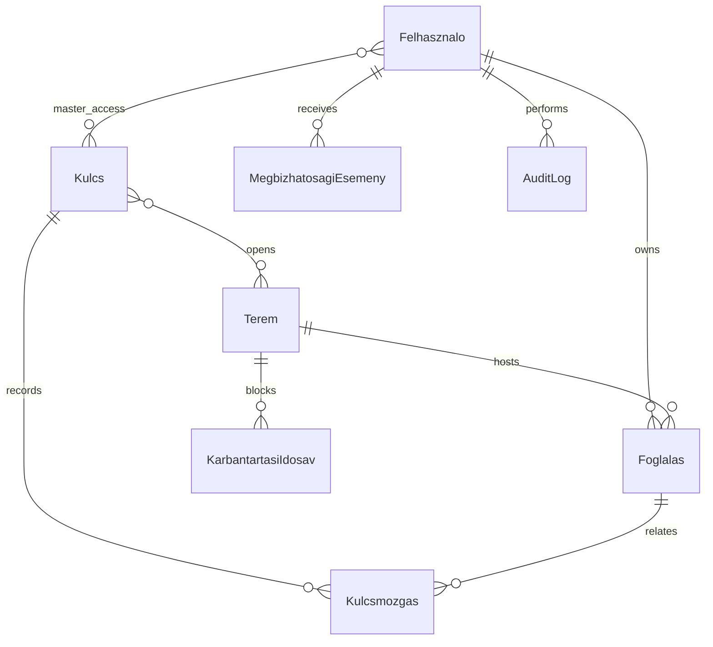
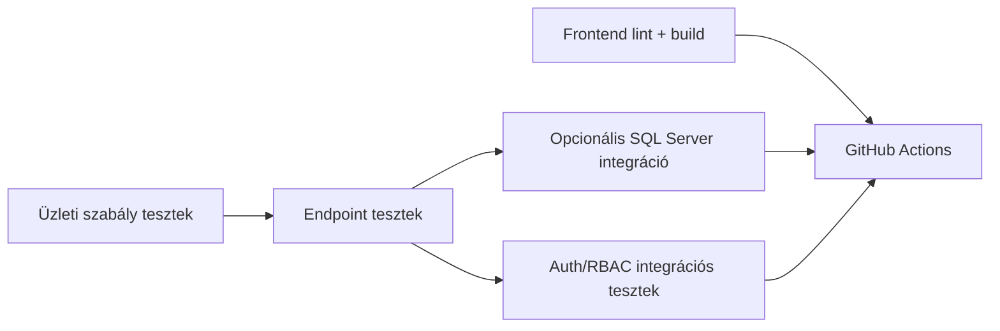

# Egyetemi kulcs- és teremnyilvántartó rendszer – projektterv

**Állapotfelvétel:** 2026. november 2.
**Cél:** a papíralapú kulcskiadás, teremfoglalás és kapcsolódó adminisztráció
nyomon követhető, szerepkörös webalkalmazássá alakítása.

## 1. Cél és hatókör



Az elsődleges cél a backend üzleti magjának lezárása és a tényleges felhasználói
felület elkészítése. A rendszer négy szerepkört kezel:

| Szerepkör | Fő feladat |
|---|---|
| `Oktato` | Saját foglalások és megbízhatósági adatok kezelése |
| `Portas` | Fizikai kulcskiadás, visszavétel és hibajegyek rögzítése |
| `Adminisztrator` | Törzsadatok, felhasználók, jogosultságok és paraméterek |
| `UzemeltetesiIgazgato` | Riportok, audit és üzemeltetési áttekintés |

## 2. Megvalósított architektúra



**Technológiai döntések:** a .NET 8 + EF Core + SQL Server kombináció erősen
típusos, jól tesztelhető és natívan támogatja a code-first migrációkat. A JWT
stateless hitelesítést ad, a policy-k a backendben kényszerítik ki a szerepköröket.
A React/TypeScript frontend későbbi fázisban kapcsolódik rá a stabil API-ra.

## 3. Backend állapot

### Elkészült modulok

| Modul | Implementált felület | Állapot |
|---|---|---|
| Hitelesítés | login, logout, current user, JWT validáció | **Kész** |
| Felhasználók | admin CRUD és szerepkörmódosítás | **Kész** |
| Termek | CRUD, elérhetőség, kulcsok | **Kész** |
| Kulcsok | CRUD, státusz, mozgások | **Kész** |
| Mesterkulcs | grant/revoke és adatbázis-egyediség | **Kész** |
| Foglalás | létrehozás, módosítás, törlés, listázás | **Kész** |
| Kulcsmozgás | kiadás, visszavétel, overdue és lista | **Kész** |
| Hibajegy | rögzítés, lekérdezés, státuszkezelés | **Kész** |
| Karbantartás | admin CRUD és ütközésvédelem | **Kész** |
| Megbízhatóság | pontozás, események, admin korrekció | **Kész** |
| Audit és paraméterek | lekérdezés, módosítás és naplózás | **Kész** |
| Riportok | daily, weekly, room-utilization, key-traffic, reliability | **Kész** |
| Health/Swagger | adatbázis health check, OpenAPI v1 | **Kész** |

### Adatbázis

Az `AppDbContext` 13 entitást kezel. A jelenlegi migrációs lánc:

1. `InitialCreate`
2. `AddMasterKeyAccessUniqueConstraint`
3. `NormalizeRoleNames`



A `SaveChanges` foglalás- és karbantartási átfedést vizsgál. Egyedi index védi
a felhasználónevet, e-mailt és a mesterkulcs–felhasználó kapcsolatot.
Konténerben az `APPLY_MIGRATIONS=true` induláskor futtatja a függő migrációkat,
legfeljebb tíz újrapróbálkozással.

## 4. Üzleti szabályok

- Foglalás: egy nap, 08:00–20:00, 45 perces rács és 45 perces egységek.
- Átfedő aktív foglalás vagy karbantartási idősáv nem menthető.
- `Megszuntetve` és `NoShow` foglalás nem blokkol új foglalást.
- No-show időkorlát alapértéke 15 perc, a napi kulcsleadási zárás alapértéke
  22:00; mindkettő rendszerparaméterként szerepel.
- Megbízhatósági pont: időben leadott 0, késedelmes +1, le nem adott vagy
  elhagyott +3; az aktív pontszám 0–100 közé korlátozott.
- A pontozási előzmények és az auditlog nem törlődnek.
- Adminisztrátori műveletek, paramétermódosítások és korrekciók auditáltak.

## 5. Tesztelési és minőségbiztosítási terv



Jelenleg 14 backend tesztfájl található, többek között:
auth, endpoint, foglalási szabály, kulcsmozgás, riport, terem, ticket,
felhasználó, security, Swagger és rendszeradminisztráció. A normál CI a külön
tesztadatbázist igénylő `SqlServerIntegrationTests` osztályt kihagyja.

Ellenőrzési parancsok:

```bash
dotnet build ProjektLabor.sln --configuration Release
dotnet test ProjektLabor.sln --configuration Release \
  --filter "FullyQualifiedName!~SqlServerIntegrationTests"

cd frontend
npm ci
npm run lint
npm run build

cd ..
docker compose --env-file .env.example config
docker compose --env-file .env.example build
```

## 6. Hiányzó és következő feladatok

| Prioritás | Feladat | Elfogadási feltétel |
|---|---|---|
| P0 | Frontend login és API kliens | JWT bejelentkezés, token-életciklus és hibakezelés működik |
| P0 | Szerepkörös frontend shell | A négy szerepkör csak a számára engedélyezett nézeteket látja |
| P0 | Foglalás/terem/kulcs UI | A fő backend folyamatok böngészőből végrehajthatók |
| P1 | No-show háttérfeldolgozó | Időzített, idempotens státuszváltás és teszt |
| P1 | 10 perces értesítés | Értesítés generálása, duplikációvédelem és megjelenítés |
| P1 | Értesítési csatorna | Dokumentált in-app, e-mail vagy push stratégia |
| P1 | Frontend komponens- és E2E tesztek | Kritikus felhasználói utak automatizáltan ellenőrizve |
| P2 | Production hardening | HTTPS, szűkített CORS, secret manager, backup és monitoring |
| P2 | Template takarítás | `/weatherforecast` eltávolítása, végpontlista újraellenőrzése |

## 7. Kockázatok és döntési pontok

- Az értesítési csatornát a frontend előtt kell kiválasztani, mert az adatmodellt
  és az üzemeltetési konfigurációt is befolyásolja.
- A háttérfeladatokhoz idempotens feldolgozás és időzóna-kezelés szükséges.
- A production JWT-kulcs és SQL-jelszó nem kerülhet repositoryba; a Compose
  fejlesztési konfiguráció, nem production deployment-sablon.
- Az általános CORS-policy éles környezetben szűkítendő.
- A törzsadatok és a tesztadatbázis elkülönítése kötelező az integrációs teszteknél.

## 8. Dokumentációs források

- [README.md](./README.md) – gyorsindítás, aktuális állapot és végpont-áttekintés
- [docs/API_DESIGN.md](./docs/API_DESIGN.md) – részletes API-szerződés
- [database/README.md](./database/README.md) – adatbázis-megjegyzések
- [`.github/workflows/ci.yml`](./.github/workflows/ci.yml) – CI lépések
