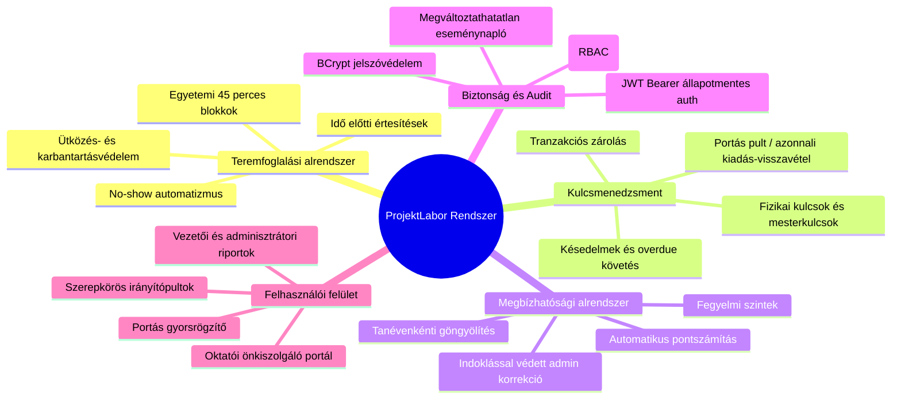
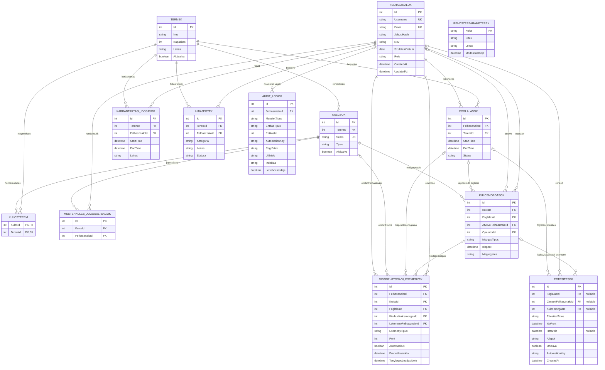
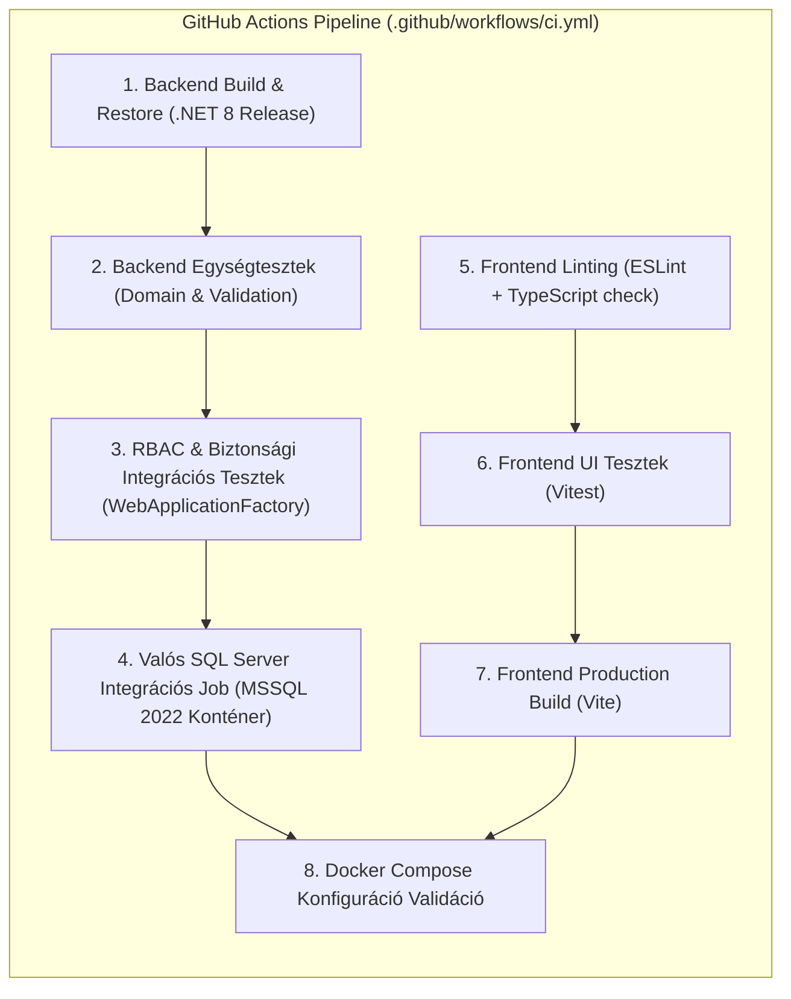

# Egyetemi Kulcs- és Teremnyilvántartó Rendszer (ProjektLabor) – Részletes Projektterv és Rendszerterv

**Dokumentum verzió:** 2.0  
**Utolsó állapotfelvétel:** 2026. november 4.  
**Cél:** A papíralapú kulcskiadás, teremfoglalás, hibajegy-kezelés és kapcsolódó adminisztráció kiváltása egy modern, automatizált, biztonságos, szerepkör-alapú webalkalmazással.

---

## 1. Vezetői összefoglaló és projektcélok

### 1.1. A probléma felvázolása
A felsőoktatási intézményekben a termek használata, a tanórák és rendezvények lebonyolítása, valamint a fizikai kulcsok kezelése hagyományosan manuális, papíralapú folyamatokra épül:
- **Átláthatatlan kulcsnyilvántartás:** A portaszolgálaton kézzel vezetett kulcsfüzetek nehezen kereshetők, a kulcsok aktuális holléte gyakran ismeretlen.
- **Késedelmes kulcsleadások és felelősség hiánya:** Nem áll rendelkezésre objektív kimutatás arról, hogy mely oktatók adják le késve vagy hagyják el a felvett kulcsokat.
- **Foglalási konfliktusok:** A termek párhuzamos foglalása, az elmaradt órák miatti felesleges teremzárolások (no-show jelenség) és a karbantartások miatti kiesések nincsenek szinkronban a valós kulcsmozgással.
- **Biztonsági kockázatok:** A mesterkulcsok felvételi jogosultsága nem ellenőrizhető megbízhatóan és azonnal.

### 1.2. A kitűzött célrendszer
A projekt célja egy olyan integrált webes alkalmazás megvalósítása, amely:
1. **Központosítja a teremfoglalásokat** és kizárja az ütközéseket karbantartási és egyéb foglalási idősávokkal.
2. **Valós időben követi a kulcsmozgásokat** (kiadás, visszavétel, késések detektálása).
3. **Automatikus megbízhatósági pontozást (SLA)** vezet a felhasználókhoz, fegyelmi következmény-szintekkel támogatva az üzemeltetést.
4. **Automatizált háttérfeladatokkal** kezeli a meg nem jelenéseket (no-show), a napi zárást és a figyelmeztető értesítéseket.
5. **Szigorú szerepkör-alapú hozzáférés-vezérlést (RBAC)** és teljes körű auditnaplózást biztosít.

---

## 2. Szerepkörök és felelősségi mátrix (RBAC)

A rendszerben négy hivatalos, kanonikus szerepkör létezik. Minden jogosultsági döntést a backend API kényszerít ki.

| Szerepkör | Fő felelősség | Funkcionális jogosultságok |
| :--- | :--- | :--- |
| **`Oktato`** | Termek igénylése és használata | - Teremkatalógus megtekintése, szabad idősávok keresése - Saját foglalások létrehozása, megtekintése, lemondása - Saját megbízhatósági pontszám és eseménytörténet lekérdezése - Saját értesítések olvasása - Hibajegy bejelentése meghibásodott terem esetén |
| **`Portas`** | Fizikai kulcsok kezelése | - Aktuális foglalások alapján kulcs kiadása a jogosult oktatónak - Kulcs visszavételének rögzítése megjegyzéssel - Kint lévő és késedelmes kulcsok listázása - Esti kulcsvisszavételi értesítések olvasása - Ad-hoc kulcskiadás engedélyezett mesterkulcsok esetén - Hibajegyek azonnali rögzítése a pultnál |
| **`Adminisztrator`** | Rendszer-törzsadatok és beállítások | - Felhasználók kezelése, jelszó- és szerepkör-módosítás - Termek és kulcsok teljes CRUD kezelése, aktiválás/inaktiválás - Mesterkulcs–terem és mesterkulcs–oktató jogosultságok beállítása - Karbantartási idősávok rögzítése és ütközésvizsgálata - Megbízhatósági pontok manuális korrekciója kötelező indoklással - Rendszerparaméterek és auditnapló megtekintése/módosítása |
| **`UzemeltetesiIgazgato`** | Intézményi felügyelet és elemzés | - Napi és heti aggregált kulcs- és foglalási riportok - Teremkihasználtsági mutatók elemzése - Kulcsforgalom és fluktuáció vizsgálata - Oktatói megbízhatósági statisztikák és fegyelmi listák - Teljes körű auditnapló ellenőrzése |

---

## 3. Rendszerarchitektúra

A rendszer háromrétegű, mikroszolgáltatás-kompatibilis, konténerizált architektúrára épül:

```mermaid
flowchart TB
    subgraph Kliens["Frontend Réteg (Single Page Application)"]
        UI["React 19 + TypeScript + Vite"]
        Router["React Router 7 (Szerepkör-védett utak)"]
        State["AuthContext + LocalStorage JWT"]
        HTTP["Axios kliens (Bearer Interceptor)"]
        UI --> Router --> State --> HTTP
    end

    subgraph Backend["Alkalmazásszerver (.NET 8 Minimal API)"]
        GW["Kéréskezelő & CORS Middleware"]
        AuthM["JWT Bearer Authentication Handler"]
        RBAC["ASP.NET Core Authorization Policy Engine"]
        
        subgraph Endpoints["Endpoint Modulok"]
            EP_Auth["Auth & User Endpoints"]
            EP_Room["Room & Key Endpoints"]
            EP_Book["Booking & Maintenance Endpoints"]
            EP_Move["KeyMovement & Ticket Endpoints"]
            EP_Rel["Reliability & Report Endpoints"]
            EP_Admin["Admin & Audit Endpoints"]
        end

        subgraph Services["Üzleti és Háttérszolgáltatások"]
            S_Auth["AuthService (BCrypt)"]
            S_Rules["BookingRules (Idősáv & Átfedés)"]
            S_Audit["AuditService (Tranzakciós napló)"]
            S_Lock["SqlServerLocking (UPDLOCK)"]
            BG_NoShow["NoShowBackgroundService"]
            BG_Closing["DailyKeyClosingBackgroundService"]
            BG_Notif["BookingExpiryNotificationBackgroundService"]
        end

        GW --> AuthM --> RBAC --> Endpoints
        Endpoints --> Services
    end

    subgraph Adatbázis["Adatréteg"]
        EF["Entity Framework Core 8 DbContext"]
        DB[("Microsoft SQL Server 2022 (KeyAndRoomDb)")]
        Vol[("Perzisztens Docker Volume: mssql-data")]
        Services --> EF --> DB --> Vol
    end

    HTTP -->|HTTPS/HTTP REST JSON| GW
```

### 3.1. Frontend megvalósítás
- **React 19 és TypeScript:** Szigorú típusosság a DTO objektumokkal.
- **Vite építőrendszer:** Gyors HMR (Hot Module Replacement) és optimalizált production bundle.
- **Tailwind CSS & Lucide ikonok:** Letisztult, akadálymentesített, modern egyetemi kezelőfelület.
- **Navigáció és védelem:** `ProtectedRoute` komponens ellenőrzi az aktuális token érvényességét és a szerepkör egyezését. Illetéktelen elérés esetén a felhasználó azonnal visszairányításra kerül.

### 3.2. Backend API megvalósítás
- **.NET 8 Minimal API:** Magas teljesítmény, alacsony memóriahasználat, logikailag szeparált `MapGroup` végpont-osztályok.
- **Állapotmentes JWT:** HMAC-SHA256 aláírással ellátott tokenek 32+ bájtos egyedi kulccsal.
- **Szerepkör-házirendek (Policies):** Deklaratív `.RequireAuthorization("PolicyName")` védelem. Ha nincs token: `401 Unauthorized`; ha a szerepkör nem megfelelő: `403 Forbidden`.

---

## 4. Adatmodell és relációs struktúra

Az adatbázis sémáját az Entity Framework Core Code-First migrációi kezelik az SQL Server 2022 környezetben. A teljes relációs entitás-kapcsolati háló:

### 4.1. Adatbázis-integritási és biztonsági megkötések
1. **Egyediségvédelem (Unique Constraints):**
   - `Felhasznalo.Username` és `Felhasznalo.Email` egyedi indexszel védett.
   - `Kulcs.Szam` egyedi kulcsazonosító.
   - `MesterkulcsJogosultsag (KulcsId, FelhasznaloId)` pár nem duplikálható.
2. **Idempotencia-indexek háttérfolyamatokhoz:**
   - `AuditLog.AutomationKey` és `Ertesites.AutomationKey` szűrt egyedi indexszel van ellátva (`WHERE AutomationKey IS NOT NULL`), így a háttérszolgáltatások még hálózati újrapróbálkozás esetén sem hozhatnak létre duplikált eseményeket vagy értesítéseket.
   - `MegbizhatosagiEsemeny.KiadasiKulcsmozgasId` egyedi indexe garantálja, hogy egyazon kulcskiadáshoz ne képződhessen kétszer automatikus büntetőpont.
3. **Konkurenciakezelés és Zárolás:**
   - Kulcskiadáskor a rendszer a `SqlServerLocking` szervizen keresztül explicit `WITH (UPDLOCK, HOLDLOCK)` szintű zárolást alkalmaz a célkulcsra, kizárva a párhuzamos kiadások versenyhelyzetét (race condition).
4. **Alapértelmezett beültetett adatok (Seed data):**
   - Rendszerparaméterek: `napi_kulcsleadasi_zarasi_idopont = "22:00"`, `no_show_idokorlat_perc = "15"`.

---

## 5. Üzleti szabályok és validációs logika

### 5.1. Foglalási szabályzat
- **Idősávok:** Egyetemi napokon 08:00 és 20:00 között engedélyezett a foglalás, 45 perces órarendi egységekben.
- **Átfedésmentesség:** Az aktív státuszú (`Aktiv`) foglalások nem fedhetik egymást ugyanabban a teremben. A foglalás érvénytelenítését az `AppDbContext.SaveChanges` és `SaveChangesAsync` metódus szintjén beépített belső validátor kényszeríti ki.
- **Karbantartási prioritás:** Karbantartási idősávval fedésben lévő időpontra nem hozható létre és nem módosítható foglalás.
- **Státuszok:** `Aktiv`, `NoShow` (nem vették fel a kulcsot időben), `Megszuntetve` (lemondott), `Kesz` (sikeresen lezárult). A `NoShow` és `Megszuntetve` státuszú tételek nem blokkolnak új foglalást.

### 5.2. Fizikai kulcskezelés és mozgások
- **Kiadás feltételei:**
  - Csak `Portas` jogosultsággal rendelkező operátor végezheti.
  - Hagyományos teremkulcs csak érvényes, aktív foglalással rendelkező felhasználónak adható ki.
  - Mesterkulcs csak az adatbázisban nyilvántartott, explicit felhatalmazással bíró felhasználónak adható ki.
  - Nem adható ki olyan kulcs, amely már kiadott állapotban van (nincs lezárva visszavétellel).
- **Visszavétel:**
  - A visszavétel időpontja rögzítésre kerül. Ha az időpont meghaladja a foglalás végét (vagy a 22:00-s zárást), a rendszer késedelmesként rögzíti a mozgást.

### 5.3. Megbízhatósági pontrendszer (Oktatói SLA)
A rendszer célja nem a büntetés, hanem a kulcsfegyelem fenntartása transzparens szabályok mentén:
- **Pontszámítási skála:** 0-tól 100 pontig terjedő megbízhatósági pontszám (ahol a magasabb pontszám rosszabb megbízhatóságot jelez). A pontszám minden tanév szeptember 1-jén nullázódik az aktuális értékeléshez, de az audit-előzmények örökre megmaradnak.
- **Események pontértékei:**
  - *Időben leadott kulcs:* 0 pont (megfelelő használat).
  - *Késedelmesen leadott kulcs:* +1 hibapont.
  - *Le nem adott kulcs (napi záráskor kint maradt):* +3 hibapont.
  - *Elhagyott kulcs:* +3 hibapont + azonnali adminisztratív eljárás.
  - *Manuális korrekció:* Adminisztrátor által adott pozitív vagy negatív pontszám (pl. igazolt technikai hiba esetén), kötelező írásos indoklással ellátva.
- **Fegyelmi következmény-szintek:**
  - **0 – 9 pont:** Normál státusz, korlátozás nélkül.
  - **10 – 19 pont:** Rendszerszintű írásbeli figyelmeztetés az oktató felületén.
  - **20 – 29 pont:** Kötelező tanszéki/üzemeltetési elbeszélgetés kezdeményezése.
  - **30+ pont:** Hivatalos biztonsági oktatás előírása, a foglalási jogosultság ideiglenes felfüggesztésének lehetősége.

### 5.4. Automatikus háttérfolyamatok (Background Services)
1. **No-Show feldolgozó (`NoShowBackgroundService`):**
   - Ciklikusan vizsgálja a folyamatban lévő foglalásokat.
   - Ha egy foglalás kezdete óta eltelt a paraméterezett türelmi idő (alapértelmezetten 15 perc), és a hozzá tartozó kulcsot nem vették át, a státuszt automatikusan `NoShow`-ra állítja, felszabadítva a termet.
2. **Napi kulcszárás feldolgozó (`DailyKeyClosingBackgroundService`):**
   - Minden este a zárási időpontban (alapértelmezetten 22:00) ellenőrzi a még le nem adott kulcsokat.
   - Automatikusan létrehozza a "Le nem adott" megbízhatósági eseményeket és auditbejegyzést.
   - A határidőkor még kint lévő kulcs minden `Portas` felhasználónak egy, az adatbázisban rögzített `EveningKeyReturn` értesítést generál. Az értesítés tartalmazza a kulcsot, a helyiséget és a kulcsmozgásból számított visszavételi határidőt; a határidő és a zárási időzóna a meglévő rendszerparamétert, illetve `Automation:TimeZoneId` beállítást használja.
   - A `KulcsmozgasId`-hez és címzetthez képzett egyedi `AutomationKey` megakadályozza az újrapróbálkozáskor keletkező duplikációt. Visszavétel után az adott kiadáshoz már nem jön létre értesítés.
   - Az `/api/notifications/my` a portások és oktatók saját értesítéseit adja vissza; a `PATCH /api/notifications/{id}/read` a címzett számára teszi olvasottá az értesítést. Az alkalmazás `/notifications` felülete a kulcsot, helyiséget, határidőt és olvasottsági állapotot jeleníti meg.
3. **Lejárat előtti értesítő (`BookingExpiryNotificationBackgroundService`):**
   - A foglalás vége előtt 10 perccel adatbázisba mentett, oktatói felületen olvasható értesítést generál.
   - E-mail-, SMS- és push-küldés nincs bekötve; a külső csatorna opcionális fejlesztési mérföldkő.

---

## 6. Tesztelési stratégia és minőségbiztosítás

A minőségbiztosítás automatizált tesztpiramisra és folyamatos integrációra (CI) támaszkodik:

### 6.1. Tesztcsomagok leírása
- **Egységtesztek (`BookingRulesTests`, `BookingValidationTests`):** Az órarendi rács, átfedések és karbantartási ütközések matematikai és logikai vizsgálata adatbázis nélkül.
- **RBAC és Biztonsági tesztek (`SecurityIntegrationTests`, `AuthEndpointTests`, `UserEndpointTests`):**
  - Mind a 4 szerepkör explicit tesztelése: jogosulatlan végponthívások `401 Unauthorized` és `403 Forbidden` válaszainak ellenőrzése.
  - Token nélküli kérések szigorú visszautasításának ellenőrzése.
  - Jelszóhashelés ellenőrzése: plain text jelszó soha nem szivároghat ki a válaszokban.
- **Valós SQL Server integrációs tesztek (`SqlServerIntegrationTests`):**
  - A CI folyamatban dedikált SQL Server szolgáltatás-konténer fut.
  - Eldobható, izolált adatbázison ellenőrzi az EF Core migrációk lefutását, a séma integritását és a seedelést.
- **Frontend UI-tesztek (`Vitest`, React Testing Library):** A felhasználói felületek célzott komponens- és interakciós tesztjei a lint és a production build mellett a CI-ben is lefutnak.

---

## 7. Megvalósítási állapot és mérföldkövek

| Mérföldkő / Komponens | Tervezett hatókör | Valós megvalósítási állapot |
| :--- | :--- | :--- |
| **M1: Backend Mag & Adatbázis** | EF Core modellek, SQL Server, migrációk, CRUD végpontok | **100% Kész** (13 entitás, egyedi indexek, zárolás) |
| **M2: Hitelesítés & RBAC** | BCrypt, JWT Bearer, 4 szerepkör, policy-k, bootstrap | **100% Kész** (Teljes jogosultsági fa lefedve) |
| **M3: Üzleti Logika & Automatizmusok** | Ütközésvizsgálat, No-Show, esti zárás, pontszámítás | **100% Kész** (Háttérszolgáltatásokkal implementálva) |
| **M4: Tesztelés & CI/CD** | xUnit tesztek, GitHub Actions workflow, Docker Compose | **100% Kész** (Minden teszt automatikusan fut) |
| **M5: Webes Felhasználói Felület (Frontend)** | React SPA, szerepkörös irányítópultok, foglalás és kulcs UI | A fő felületek elkészültek; a teljes üzleti folyamatok böngészős ellenőrzése külön validációt igényel |
| **M6: Külső Értesítési Csatornák (Opcionális)** | E-mail vagy SMS integráció | *Tervezett (P1)* – A foglalásvége- és esti kulcsvisszavételi értesítések jelenleg az adatbázisban tárolt in-app üzenetek |
| **M7: Éles Üzemeltetési Hardening** | Kereskedelmi SSL tanúsítvány, szigorúbb CORS, külső loggyűjtő | *Tervezett (P2)* – Üzembe helyezés előtti fázis |

---

## 8. Kockázatkezelés és döntési napló

1. **Konkurens kulcskiadás kockázata:**
   - *Probléma:* Ha két portás egyszerre próbálja kiadni ugyanazt a kulcsot két különböző ablakban.
   - *Megoldás:* Adatbázisszintű `UPDLOCK, HOLDLOCK` tranzakciós zárolás alkalmazása a kulcsrekordon a kiadási tranzakció idejére.
2. **Időzónák és nyári időszámítás:**
   - *Megoldás:* Az adatbázisban és az API kommunikációban kizárólag **UTC (ISO 8601)** időbélyegek közlekednek, a helyi időzónára való konverziót kizárólag a kliens felület végzi el.
3. **Auditnapló megmásíthatatlansága:**
   - *Megoldás:* Az `AuditLog` és `MegbizhatosagiEsemeny` táblákhoz kizárólag `INSERT` és `SELECT` művelet engedélyezett az API-n keresztül; módosító vagy törlő végpont ezekre nem létezik.
4. **Bizalmas adatok védelme:**
   - *Megoldás:* A jelszavak a modern BCrypt algoritmus 12-es költségfaktorával vannak hashelve; a JWT titkos kulcsa és az SA jelszó kizárólag környezeti változókból (`.env`) olvasódik, forráskódban nem commitolható.
