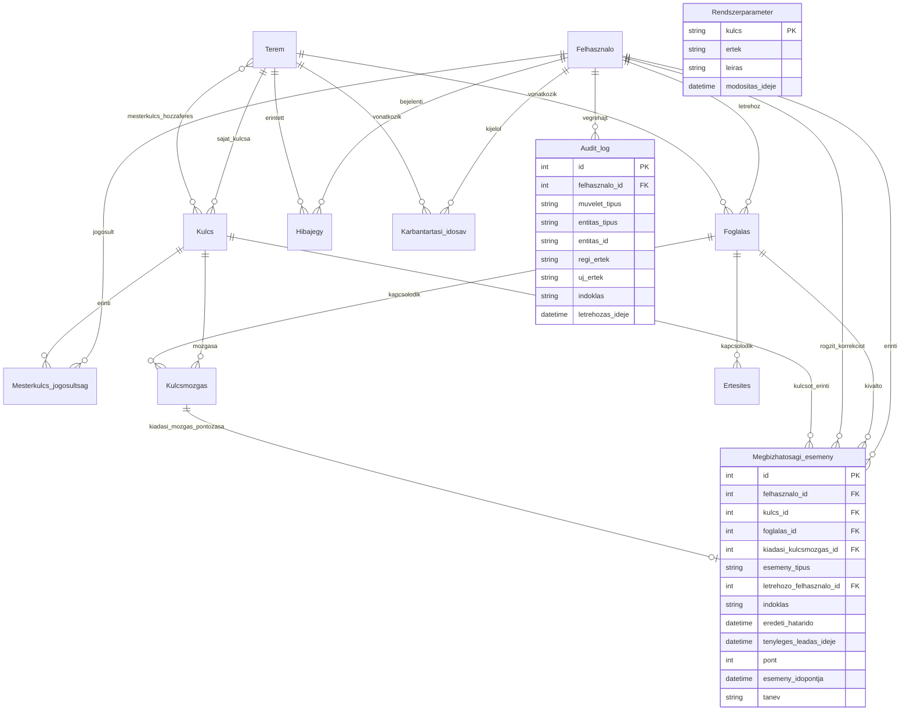
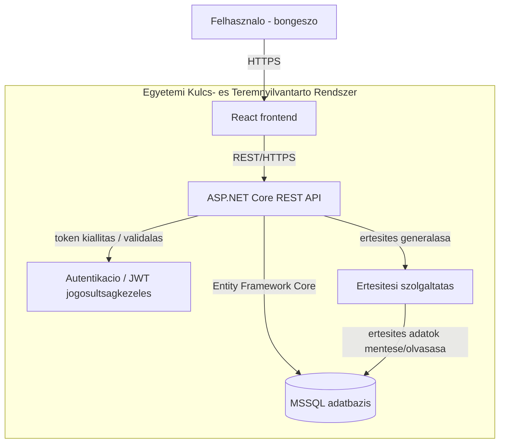

# Egyetemi Kulcs- és Teremnyilvántartó Rendszer - Rendszertervezési dokumentum

## 1. Projekt célja és problémameghatározás

Az egyetem informatika karán a teremkulcsok kiadása és visszavétele jelenleg papíralapon, kézzel vezetett füzetben történik. Ez a gyakorlat több rendszerszintű problémát okoz:

- a bejegyzések kézírással készülnek, utólag nehezen vagy bizonytalanul értelmezhetők,
- a kulcsátvétel aláírása nem nyújt megbízható azonosítást,
- nincs központi, valós idejű nyilvántartás, ezért a teremfoglalások átfedhetnek és ütközhetnek,
- egy adott kulcs vagy terem előzményeinek visszakeresése lassú és megbízhatatlan.

A rendszer célja ezen folyamatok digitalizálása egy központi, webes alkalmazás formájában. A rendszer az alábbi fő folyamatokat fedi le:

- teremfoglalás 45 perces időszeletekben, automatikus ütközésvizsgálattal,
- kulcsok kiadásának és visszavételének rögzítése, digitális azonosítással,
- teremállapot és esetleges sérülések dokumentálása minden kulcsmozgásnál,
- hibajegyek kezelése,
- napi és heti riportok, valamint késedelmes, le nem adott és elhagyott kulcsok jelzése,
- minden rendszerművelet visszakövethető rögzítése (audit log).

A rendszer minden felhasználó számára egyetlen, egységes webes felületen érhető el, amely a bejelentkezett felhasználó szerepköre alapján jeleníti meg a releváns funkciókat.

## 2. Architektúra

A rendszer webalkalmazásként, kliens-szerver architektúrával valósul meg. Az egyes komponensek és a mögöttük álló technológiai döntések az alábbiak:

**Frontend: React + TypeScript**

Szerepe: a felhasználói felület biztosítása, amely a bejelentkezett felhasználó szerepköre alapján jeleníti meg a funkciókat. Node.js alapú fejlesztői környezetben/toolinggal készül.

Indoklás: a csapat az egyszerűsége, valamint a köré épült széleskörű lehetőségek (könyvtárak, komponensek, minták) miatt választotta.

Előnyök: nagy közösség és érett ökoszisztéma, könnyen bővíthető komponensalapú felépítés, a TypeScript statikus típusellenőrzése csökkenti a futásidejű hibák számát nagyobb kódbázisban.

Hátrányok: a sok elérhető könyvtár és megoldás miatt csapaton belül könnyen inkonzisztens gyakorlat alakulhat ki, a TypeScript extra build-/konfigurációs réteget ad a projekthez.

**Backend: C# / ASP.NET Core, REST API**

Szerepe: üzleti logika végrehajtása, jogosultságkezelés (RBAC), a foglalási ütközésvizsgálat és a pontozási szabályok érvényesítése.

Indoklás: a csapat az egyszerűsége miatt, valamint azért választotta, mert ez a legtöbbek által ismert nyelv/keretrendszer a csapaton belül.

Előnyök: erősen típusos nyelv, kiforrott és jól dokumentált keretrendszer, natív és megbízható MSSQL integráció, beépített dependency injection és middleware rendszer.

Hátrányok: elsősorban a .NET ökoszisztémához köti a projektet, kevesebb "könnyűsúlyú" eszköz érhető el hozzá, mint pl. egyes Node.js alapú backend megoldásokhoz.

**Adatbázis: Microsoft SQL Server (MSSQL)**

Szerepe: a rendszer teljes adatállományának tartós, relációs tárolása.

Indoklás: egyszerűség, valamint az, hogy a csapat ezt tanulta az egyetemen, így nem szükséges új adatbázis-motort megismerni a projekt mellett.

Előnyök: jó eszköztámogatás (pl. SSMS, Azure Data Studio), megbízható tranzakciókezelés, jól illeszkedik az ASP.NET Core / Entity Framework Core párossal.

Hátrányok: kevésbé platformfüggetlen, mint pl. PostgreSQL, éles/kereskedelmi környezetben licencköltséggel járhat (egyetemi/fejlesztői célra ingyenesen elérhető).

**ORM: Entity Framework Core**

Szerepe: adatelérési réteg a backend és az MSSQL adatbázis között.

Indoklás: natívan illeszkedik az ASP.NET Core-hoz, code-first migrációkat biztosít, így az adatbázis-séma verziózható.

Előnyök: gyorsítja a fejlesztést, csökkenti a kézzel írt SQL mennyiségét, típusbiztos lekérdezéseket tesz lehetővé (LINQ).

Hátrányok: összetettebb lekérdezéseknél a generált SQL nem mindig optimális, teljesítménykritikus helyeken kézi finomhangolás szükséges lehet.

**Rendszerbelépés (autentikáció): JWT**

Szerepe: felhasználói bejelentkezés és a REST API hívások hitelesítése.

Indoklás: stateless megoldás, amely jól illeszkedik a REST API architektúrához, és nem igényel szerver oldali munkamenet-tárolást.

Előnyök: jól skálázható, egyszerűen integrálható ASP.NET Core-ba.

Hátrányok: a kiadott token érvényességi ideje alatt nem vonható vissza egyszerűen, a token kliens oldali tárolása külön odafigyelést igényel.

A kommunikáció iránya: a React frontend REST hívásokat kezdeményez az ASP.NET Core API felé; az API hitelesíti és jogosultság szerint ellenőrzi a kérést, majd Entity Framework Core-on keresztül olvassa vagy módosítja az MSSQL adatbázisban tárolt adatokat, és a választ JSON formátumban adja vissza a kliensnek. Az adatbázis közvetlenül nem érhető el a frontendről.

## 3. Felhasználói szerepkörök és jogosultságok

A rendszer négy szerepkört különböztet meg. Minden felhasználóhoz pontosan egy szerepkör tartozik.

- **Oktató / Igénylő**
  - Jogosult: saját terem- és idősáv-foglalások létrehozására; saját foglalásainak megtekintésére és kezelésére; a foglaláshoz speciális igények (pl. labor, projektor) megadására; saját megbízhatósági pontszámának és a hozzá kapcsolódó pontozási eseményeknek a megtekintésére.
  - Nem jogosult: kulcs kiadásának vagy visszavételének rendszerbeli rögzítésére; más felhasználók foglalásainak módosítására; rendszerparaméterek megtekintésére vagy módosítására; megbízhatósági pontok manuális módosítására; az audit log módosítására vagy törlésére.
- **Portás / Operátor**: feladata a tényleges fizikai kulcsmozgások rögzítése.
  - Jogosult: kulcs kiadásának rögzítésére; annak rögzítésére, hogy az adott oktató ténylegesen átvette a kulcsot; kulcs visszavételének/leadásának és a leadás pontos időpontjának rögzítésére; digitális jóváhagyás/azonosítás kezelésére (PIN, kártya vagy aláírás); hibajegyek és rendellenességek rögzítésére; az aktuális kulcsállapot és a hozzá tartozó kulcsmozgások megtekintésére; a kulcsokhoz kapcsolódó foglalások megtekintésére, amennyiben ez a kulcskiadás ellenőrzéséhez szükséges.
  - Nem jogosult: megbízhatósági pontszám manuális módosítására; pontozási esemény törlésére vagy átírására; rendszerparaméterek megtekintésére vagy módosítására; más felhasználók jogosultságainak módosítására; az audit log utólagos módosítására vagy törlésére.
  - A portás által rögzített kulcskiadási és kulcsleadási eseményekből a rendszer automatikusan határozza meg az esemény típusát és a hozzá tartozó pontot; a portás nem dönti el manuálisan, hogy egy esemény +1 vagy +3 pontot ér.
- **Adminisztrátor**
  - Jogosult: terem- és kulcstörzsadatok kezelésére; felhasználók és szerepkörök kezelésére; mesterkulcs-jogosultságok beállítására; karbantartási idősávok kezelésére; az oktatók megbízhatósági pontszámának megtekintésére; rendszerparaméterek megtekintésére és módosítására (ideértve a konfigurálható no-show időkorlátot és a napi kulcsleadási zárási időt); szükség esetén manuális korrekciós pontozási esemény rögzítésére.
  - A manuális korrekciós pontozás kötelezően auditált: rögzítésre kerül, hogy ki módosította, mikor, melyik oktatót érintette, milyen értékről milyen értékre módosult az aktív megbízhatósági pontszám, és mi volt a módosítás indoka.
  - Nem jogosult: az `Audit_log` bejegyzéseinek törlésére vagy visszamenőleges módosítására.
- **Üzemeltetési Igazgató**
  - Jogosult: riportok és teremkihasználtsági statisztikák megtekintésére; kulcsforgalmi és megbízhatósági statisztikák megtekintésére; audit logok megtekintésére és elemzésére; rendszerparaméterek megtekintésére.
  - Nem jogosult: rendszerparaméterek módosítására; kulcsmozgások utólagos módosítására; megbízhatósági pontok manuális módosítására; felhasználói jogosultságok módosítására.

A rendszer két, egymástól elkülönülő azonosítási mechanizmust különböztet meg:

- **Rendszerbejelentkezés**: minden felhasználó (mind a négy szerepkörben) saját, egyedi felhasználói fiókkal, JWT alapú hitelesítéssel lép be a rendszerbe.
- **Kulcsátvételhez használt azonosítás**: a portán, fizikai kulcsmozgáskor alkalmazott azonosítás (PIN kód, kártya vagy aláírás). Ez nem azonos a rendszerbejelentkezéssel.

Minden funkcióhoz szerepkör alapú jogosultság-ellenőrzés (RBAC) tartozik a backend oldalon.

Általános jogosultsági szabályok:

- Minden szerepkör csak a saját jogosultságaihoz tartozó műveleteket végezheti.
- Minden fizikai kulcskiadás és kulcsleadás rendszer által generált időbélyeggel kerül rögzítésre.
- A kulcsmozgások utólagos módosítása nem engedélyezett szabadon.
- A jogosultságot igénylő vagy módosító adminisztrátori műveletek, valamint a rendszerparaméterek módosítása az `Audit_log`-ba kerülnek.
- A megbízhatósági pontszám automatikusan számított érték; manuálisan csak auditált adminisztrátori korrekciós eseménnyel módosítható.
- A portás által rögzített kulcsmozgásból a rendszer automatikusan határozza meg az esemény típusát és a hozzá tartozó pontot.
- A pontozási események története továbbra is teljes egészében megőrzendő, a 100 pontos maximális aktuális megbízhatósági pontszám mellett is.

## 4. Fő funkcionális modulok

- **Foglalási rendszer**: 45 perces időszeletekre épülő teremfoglalás (egy foglalás egy vagy több egymást követő időszeletből áll), automatikus ütközésvizsgálat, szűrés teremjellemzők alapján, no-show kezelés.
- **Kulcskezelés**: kulcsok kiadásának és visszavételének rögzítése, digitális azonosítás, teremállapot és sérülések dokumentálása.
- **Hibajegykezelés**: hibajegyek felvétele teremhez és hibakategóriához kötve.
- **Karbantartás**: adminisztrátor által kijelölt karbantartási idősávok kezelése.
- **Riportok**: napi és heti forgalmi kimutatások, teremkihasználtsági statisztikák.
- **Audit**: minden rendszerművelet visszakövethető naplózása.
- **Értesítések**: figyelmeztetés az oktatónak 10 perccel a foglalás vége előtt.
- **Megbízhatósági pontozás**: oktatónkénti, eseményalapú megbízhatósági pontszám-számítás a kulcsleadási fegyelem alapján, tanévenkénti érvényességgel és küszöbalapú következményekkel.

## 5. Extra funkciók

A csapat két extra funkciót választott, amelyek illeszkednek az alaprendszer adatmodelljébe.

Az extra funkciók választásának közös indoklása: mindkettő auditálási célt szolgál, segíti az oktatókat abban, hogy időben be tudják fejezni az órát és elkerüljék a büntetőpontot, valamint mindkettőről kimutatások, riportok készíthetők az Üzemeltetési Igazgató számára.

### 5.1. Foglalás vége előtti értesítés

**Probléma**: az oktató jelenleg nem kap figyelmeztetést arról, hogy a foglalt időszak hamarosan lejár.

**Működés**: a rendszer a foglalás vége előtt 10 perccel figyelmeztető értesítést küld az oktatónak.

**Üzleti szabály**: az értesítés kizárólag figyelemfelhívás - nem jár automatikus büntetéssel, nem törli a foglalást és nem tiltja le a felhasználót. A tényleges késedelmes, le nem adott vagy elhagyott kulcs ettől független, külön üzleti esemény.

**Szükséges adatmodell**: a foglaláshoz kapcsolódó `Ertesites` entitás, amely rögzíti az értesítés generálásának/kiküldésének időpontját, elősegítve, hogy egy foglaláshoz ne generálódjon duplikált értesítés, és hogy a kiküldés állapota visszakövethető és auditálható legyen.

**Érintett szerepkörök**: Oktató / Igénylő (értesítés címzettje).

### 5.2. Oktatói megbízhatósági pontszám

**Probléma**: jelenleg nincs rendszerszintű nyilvántartás arról, hogy egy oktató mennyire tartja be a kulcsleadási határidőket.

**Működés**: minden kulcskezelési eseményhez (időben leadott, késedelmesen leadott, le nem adott vagy elhagyott kulcs) a rendszer pontozási eseményt rögzít az érintett oktatóhoz. Egyetlen kulcskezelési eseményből csak egy végleges pontozási esemény keletkezhet.

**Pontozási események**:

| Esemény típusa | Büntetőpont |
|---|---|
| Időben leadott kulcs | 0 |
| Késedelmesen leadott kulcs | +1 |
| Le nem adott kulcs | +3 |
| Elhagyott kulcs | +3, valamint az elhagyott kulcs pótlási díját az oktatónak meg kell fizetnie |

**Késedelmes kulcsleadás**: a kulcs leadási határideje alapértelmezetten az adott kulcs használati/foglalási időszakának vége. Ha az oktató a kulcsot a használati időszak végéig nem adja le, de az adott nap napi zárási időpontjáig visszaszolgáltatja, az esemény késedelmes kulcsleadásnak minősül (+1 büntetőpont). A napi zárási időpont konfigurálható rendszerparaméter (lásd 6. fejezet, `Rendszerparameter`), így később módosítható; alapértelmezett értéke 22:00.

**Le nem adott kulcs**: ha az oktató a kulcsot a napi zárási időpontig sem szolgáltatja vissza, az esemény le nem adott kulcsnak minősül (+3 büntetőpont). A pontozási esemény végleges típusa a napi zárási időpont lejártakor dől el, ezért egy kulcsra nem keletkezik külön +1 és +3 büntetőpont: ha a kulcs a napi zárási időpontig nem kerül vissza, kizárólag a +3 büntetőpont számít. A másnap történő leadás nem generál újabb büntetőpontot, mert az esemény már le nem adott kulcsként került rögzítésre; a tényleges visszaadás a kulcsmozgásban továbbra is rögzítésre kerül. Példa: ha egy kulcs használati időszaka 16:00-kor jár le, és 17:00-kor visszakerül, az +1 pont; ha viszont a kulcs a napi zárási időpontig sem kerül vissza, az esemény végleges állapota „le nem adott kulcs”, és csak +3 pont jár érte, külön +1 pont nélkül.

**Megbízhatósági pontszám és küszöbök**: a megbízhatósági pontszám az oktató aktuális, összesített pontszáma, amely az érvényes tanévben rögzített pontozási eseményekből (büntetőpontokból) számítható. Az aktuális/aktív pontszám 0 és 100 közötti lehet: a minimum 0, a maximum 100, a 100 pont érvényes érték. Ha egy esemény miatt az érték 100 fölé menne, az aktuális pontszám 100 marad, a pontozási esemény viszont a tényleges értékével kerül rögzítésre az előzményekben és az auditban (pl. 99 pontnál egy +3 pontos esemény +3 marad, az aktuális pontszám pedig 100). A 100 pont elérése után az új pontozási események rögzítése nem tiltott. A 100 pontos felső határ kizárólag a pontszám maximális értékét jelenti, nem hoz létre további következményi szintet. A határt a backend validációja kényszeríti ki, a frontend pedig hiba nélkül kezeli és megjeleníti a 100 pontos értéket. A pontszám alapján, a küszöb elérésekor az adott következmény automatikusan alkalmazandó:

- 0–9 pont: nincs külön intézkedés, az események csak naplózásra kerülnek.
- 10–19 pont: figyelmeztetés.
- 20–29 pont: kötelező személyes elbeszélgetés.
- 30–100 pont: kötelező személyes elbeszélgetés és kulcskezelési/biztonsági tréning.

A 30 pont feletti értékekhez nincs további, külön szankciós kategória.

**Érvényesség**: a megbízhatósági pontszám egy tanévre érvényes. A tanév lezárásakor az aktív megbízhatósági pontszám 0-ra áll vissza, és az új tanévben új pontozási időszak kezdődik. A korábbi pontozási események és auditadatok nem törlődnek, statisztikai és visszakeresési célból megmaradnak; csak az aktív pontszám nullázódik.

**Szükséges adatmodell**: önálló `Megbizhatosagi_esemeny` entitás, amely az oktatóhoz, a kulcshoz, a foglaláshoz és az eredeti kulcskiadási mozgáshoz (foglalás–kulcs ciklushoz) kapcsolódik, így visszakereshető az eredeti kulcskiadás. A folyamat: foglalás → kulcs kiadása → leadás / késedelmes leadás / le nem adott kulcs. Le nem adott kulcs esetén nincs visszavételi kulcsmozgás, és ilyen mesterséges rekord nem jön létre; a pontozási esemény ilyenkor is a kiadási mozgáshoz kötődik. Egy kulcskezelési eseményhez legfeljebb egy végleges, automatikusan keletkező pontozási esemény tartozhat (a manuális korrekciós események ettől függetlenek, és nem kulcsmozgáshoz kötődnek). Minden pontozási esemény visszakereshető, és legalább az alábbi adatokat tartalmazza:

- oktató azonosítója,
- kulcs azonosítója,
- esemény típusa,
- eredeti leadási határidő,
- tényleges leadási idő (le nem adott vagy elhagyott kulcs esetén üres lehet),
- kiosztott pont (büntetőpont; 0 pont az időben leadott kulcsnál),
- esemény időpontja,
- manuális korrekció esetén a rögzítő adminisztrátor és az indoklás,
- a pontozási időszak (tanév) azonosítója, amelyhez az esemény tartozik.

Az összesített megbízhatósági pontszám nem kerül külön mezőben tárolásra (ez redundáns és 3NF-sértő lenne), hanem az aktuális pontozási időszak eseményeiből számítandó. A tanévváltáskor ezért a korábbi események törlése nélkül áll vissza 0-ra az aktív pontszám, a régebbi események pedig statisztikai és auditálási célra továbbra is felhasználhatók.

**Manuális korrekció és auditálása**: az aktív megbízhatósági pontszám manuálisan kizárólag az adminisztrátor által rögzített, auditált korrekciós pontozási eseménnyel módosítható; a meglévő pontozási események nem törölhetők és nem írhatók át, a történet teljes egészében megmarad. A korrekciós esemény pontértéke az adminisztrátor által megadott érték (lehet negatív is), és indoklása kötelező. A művelet auditnyomot hagy az `Audit_log`-ban: rögzítésre kerül, hogy ki, mikor, melyik oktatót érintően, milyen értékről milyen értékre módosította az aktív pontszámot, és milyen indokkal. Az `Audit_log` bejegyzései utólag nem módosíthatók és nem törölhetők, az adminisztrátor által sem. A kulcskezelési eseményekből keletkező pontozási eseményt és annak pontértékét a rendszer a rögzített kulcsmozgásból automatikusan határozza meg.

**Érintett szerepkörök**: Oktató / Igénylő (saját megbízhatósági pontszám és pontozási események megtekintése), Portás / Operátor (az eseményt kiváltó kulcsmozgás és a leadás pontos időpontjának rögzítése; a pontot a rendszer határozza meg, a portás nem módosíthatja), Adminisztrátor (megtekintheti az oktatók megbízhatósági pontszámát, és indoklással, auditálva manuális korrekciós pontozási eseményt rögzíthet) és Üzemeltetési Igazgató (rendszerszintű kimutatásokat és statisztikákat készíthet a megbízhatósági adatokból, módosítási jog nélkül).

## 6. Adatmodell

**Az adatmodell kiegészítő leírása**

- **Foglalás és időszeletek**: a foglalás 45 perces időszeletekre épül; egy foglalás egy vagy több egymást követő, szabad időszeletből áll. Az ütközésvizsgálat az időszeletek alapján működik.
- **`Megbizhatosagi_esemeny`**: a `pont` értéke az eseménytípusból következik (0, 1 vagy 3); az `esemeny_tipus` lehet időben leadott, késedelmesen leadott, le nem adott vagy elhagyott kulcs, illetve adminisztrátori manuális korrekció. Kulcsmozgásból a típust és a pontot a rendszer automatikusan határozza meg; a `letrehozo_felhasznalo_id` és az `indoklas` kizárólag manuális korrekciónál kitöltött (az indoklás ilyenkor kötelező), és a korrekció a kulcsmozgástól független, nem módosítja a korábbi eseményeket. A `tenyleges_leadas_ideje` le nem adott vagy elhagyott kulcs esetén üres lehet. A `tanev` azonosítja a pontozási időszakot; az aktív megbízhatósági pontszám (0–100) nem tárolt mező, hanem az aktuális tanév eseményeiből számított, 0 és 100 közé korlátozott érték. Az események mindig a tényleges pontértékükkel maradnak meg (pl. 99 pontnál egy +3 esemény +3 marad, az aktuális pontszám pedig 100), és 100 pont elérése után is rögzíthetők új események.
- **`Audit_log`**: minden rendszerművelet auditnyoma; rögzíti a végrehajtót, az időpontot, az érintett entitást és műveletet, a korábbi és új értéket, valamint manuális módosításnál az indoklást. Az adminisztrátori manuális korrekciós pontozási események (az érintett oktatóval, a régi és új aktív pontszámmal, indoklással) és a rendszerparaméterek módosításai is ide naplózódnak. A bejegyzések utólag nem módosíthatók és nem törölhetők, az adminisztrátor által sem.
- **`Rendszerparameter`**: konfigurációs tábla kulcs–érték párokkal. Legalább a `napi_kulcsleadasi_zarasi_idopont` (alapértelmezett: `22:00`) és a `no_show_idokorlat_perc` (alapértelmezett: `15`) paraméter számára van hely; az értékeket az Adminisztrátor módosíthatja, az Üzemeltetési Igazgató csak megtekintheti; a Portás / Operátor és az Oktató / Igénylő nem fér hozzá. Minden módosítás az `Audit_log`-ba kerül (régi érték, új érték, módosító felhasználó, időpont, szükség esetén indoklás).

## 7. Rendszerterv vázlat

## 8. Fontos üzleti szabályok

- A foglalási rendszer 45 perces időszeletekkel működik, és egy foglalás egy vagy több egymást követő, szabad 45 perces időszeletből állhat (pl. 45 perc = 1 időszelet, 90 perc = 2, 135 perc = 3 egymást követő időszelet). Az időpontok kezelése és az ütközésvizsgálat 45 perces pontossággal, az időszeletek alapján történik.
- Egy teremre azonos időszakban ütköző foglalás nem engedélyezett.
- Ha a foglalás kezdő időpontjától számított, konfigurálható időn belül (rendszerparaméter, alapértelmezés: 15 perc) nem történik kulcsfelvétel, a foglalás „meg nem jelent” (no-show) státuszt kap, és a terem újra szabaddá válik.
- Kulcs csak megfelelő jogosultsággal adható ki.
- Késedelmes, le nem adott vagy elhagyott kulcs automatikusan jelzésre kerül.
- A rendszer 10 perccel a foglalás vége előtt figyelmeztető értesítést küld az oktatónak.
- A megbízhatósági pontozás szabályai: időben leadott kulcs 0 pont, késedelmesen leadott kulcs +1 büntetőpont, le nem adott kulcs +3 büntetőpont, elhagyott kulcs +3 büntetőpont és a pótlási díj megfizetése az oktató által. Egy kulcskezelési eseményből csak egy végleges pontozási esemény keletkezhet.
- A kulcs leadási határideje alapértelmezetten a használati/foglalási időszak vége; a napi zárási időpontig történő leadás késedelmes (+1), a napi zárási időpontig sem leadott kulcs le nem adott (+3). A napi zárási időpont és a no-show időkorlát konfigurálható rendszerparaméter (alapértelmezett: 22:00, illetve 15 perc).
- Az aktuális megbízhatósági pontszám 0 és 100 közötti érték (100 pont érvényes érték); ha egy esemény miatt 100 fölé menne, az aktuális pontszám 100 marad, a pontozási esemény viszont a tényleges értékével kerül rögzítésre, és 100 pont elérése után is rögzíthetők új pontozási események.
- Megbízhatósági küszöbök: 0–9 pont: nincs külön intézkedés (csak naplózás); 10–19 pont: figyelmeztetés; 20–29 pont: kötelező személyes elbeszélgetés; 30–100 pont: kötelező személyes elbeszélgetés és kulcskezelési/biztonsági tréning. A következmény a küszöb elérésekor automatikusan érvényesül.
- A megbízhatósági pontszám egy tanévre érvényes; a tanév lezárásakor az aktív pontszám 0-ra áll vissza, a korábbi pontozási események és auditadatok megmaradnak.
- Minden pontozási esemény visszakereshető; a pontozási események nem törölhetők és nem írhatók át; manuális módosítás kizárólag auditált adminisztrátori korrekciós eseménnyel lehetséges (ki, mikor, melyik oktatót érintően, milyen értékről milyen értékre, milyen indokkal).
- A rendszerparaméterek megtekintése és módosítása az Adminisztrátornak, megtekintése az Üzemeltetési Igazgatónak engedélyezett; a Portás / Operátor és az Oktató / Igénylő nem fér hozzá. A módosítás az `Audit_log`-ba kerül (régi érték, új érték, módosító felhasználó, időpont, szükség esetén indoklás).
- Ha egy karbantartási idősáv ütközik egy meglévő foglalással, a rendszer figyelmezteti az adminisztrátort, és feltünteti az érintett foglalás(oka)t.
- Minden felhasználó egyedi, saját fiókkal lép be a rendszerbe; ez elkülönül a kulcsátvételhez használt azonosítástól.

